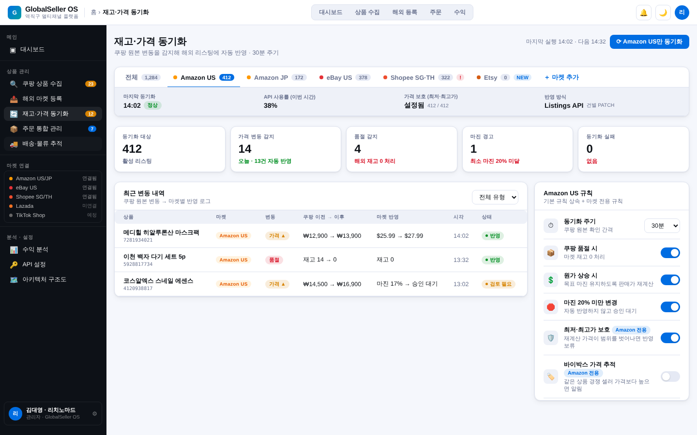
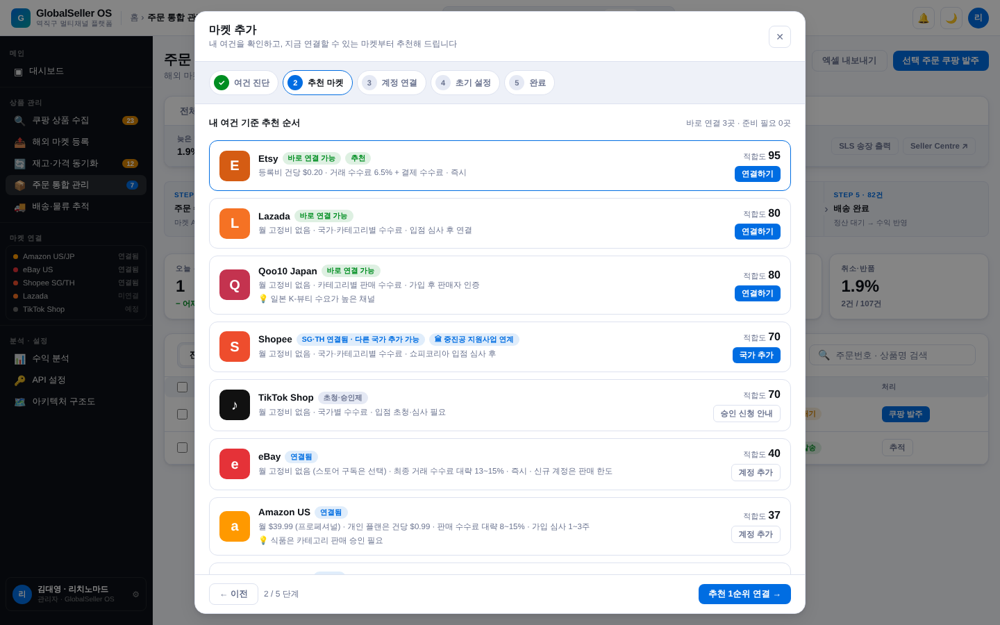
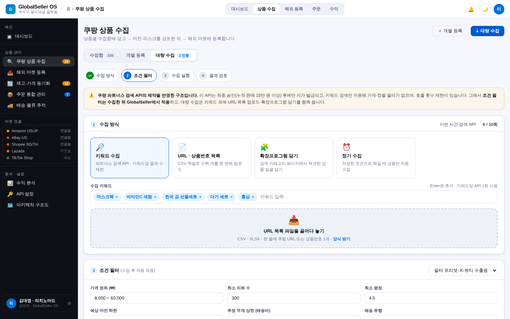
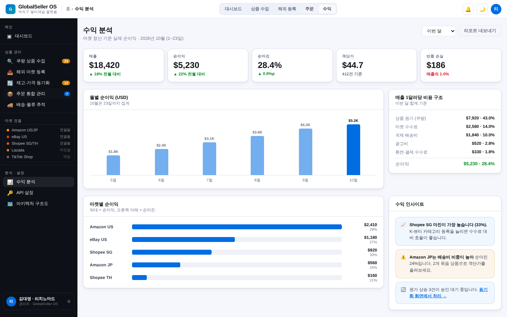

# GlobalSeller OS

쿠팡에서 수집한 국내 상품을 Amazon · eBay · Shopee · Lazada 등 해외 마켓에 등록하고, 재고·가격 동기화부터 주문·배송·수익 분석까지 한 화면에서 운영하는 **역직구 멀티채널 SaaS**의 기획·프로토타입 레포입니다.

> 현재 단계: **클릭 가능한 HTML 프로토타입 + 기획 문서**. 실제 마켓 API 연동 전, 화면 구조와 운영 흐름을 검증하는 단계입니다.

## 바로 보기

| 방법 | 설명 |
| --- | --- |
| 로컬 | `prototype/index.html`을 브라우저로 열기 (빌드 불필요, 단일 파일) |
| GitHub Pages | Settings → Pages → Branch `master` / 폴더 `/(root)` 선택 후 `https://devops0906.github.io/globalselleros/prototype/` |

## 화면 구성

| 메뉴 | 주요 기능 |
| --- | --- |
| 대시보드 | 마켓 통합 매출·주문 KPI, 최근 활동, 수집→등록 현황 |
| 쿠팡 상품 수집 | **수집함 / 개별 등록 / 대량 수집** 하위 탭. 개별: URL·확장프로그램 → 옵션 → 리스크 검사 → 저장. 대량: 키워드·URL 목록·확장프로그램·정기 수집 + 수집 후 조건 필터 |
| 해외 마켓 등록 | **등록 현황 / 개별 등록 / 일괄 등록**. 개별: 6단계(원본·마켓·AI 번역·가격·카테고리·이미지), 판매가 실시간 계산. 일괄: 규칙 템플릿 → 사전 검증 → 대기열 실행 |
| 재고·가격 동기화 | **전체 탭 + 마켓별 탭**. 변동 로그, 기본 규칙 + 마켓 전용 규칙(Amazon 가격 보호, eBay 품절 리스팅 유지, Shopee 토큰 갱신) |
| 주문 통합 관리 | **전체 탭 + 마켓별 탭** × 상태 필터. 마켓별 계정 건전성 지표(ODR, 지연 발송률, LSR 등) |
| 배송·물류 추적 | **전체 탭 + 마켓별 탭**. 구간별 타임라인, 운송사 비교 |
| 수익 분석 | 월별 순이익, 비용 구조, 마켓별 순이익, 상위 상품 |
| API 설정 / 구조도 | 마켓 API 사양·비용, 시스템 아키텍처 |
| 내 계정 | 프로필, 구독 플랜, 마켓 연결, API 키, 결제, 알림, 보안, 팀 멤버 (8개 탭) |
| 마켓 추가 마법사 | 여건 진단 7문항 → 적합도 추천 → 계정 연결 → 초기 설정 → 완료 시 운영 메뉴에 마켓 탭 자동 생성 |

반응형 기준: 모바일 ~767px · 태블릿 768~1199px · 데스크탑 1200px~ (구간별 제목·KPI 글자 크기 지정, 모바일은 상단 가로 메뉴).

## 스크린샷

| 재고·가격 동기화 (Amazon US 탭) | 마켓 추가 마법사 |
| --- | --- |
|  |  |
| **쿠팡 대량 수집** | **수익 분석** |
|  |  |

## 폴더 구조

```
prototype/
  index.html          # 단일 파일 프로토타입 (HTML + CSS + JS, 라이트/다크 테마)
  screenshots/        # 화면 캡처
docs/
  planning-update-2026-10-23.md   # 마켓 탭 · 마켓 추가 · 상품 수집 기획 + 벤치마킹
tests/
  prototype-smoke.js  # 메뉴·탭·필터·마법사 동작 확인 (Playwright)
```

## 동작 확인

```bash
npm install
npm test        # Chromium으로 prototype/index.html 의 메뉴·마켓 탭·마법사를 클릭하며 확인
```

설치된 Chromium을 쓰려면 `CHROMIUM_PATH=/path/to/chromium npm test`.

## 다음 단계 (MVP 제안)

1. 쿠팡 **URL 목록 업로드 + 크롬 확장프로그램 수집**부터 구현 — 파트너스 API 승인 없이 바로 검증 가능
2. 주문 → 쿠팡 발주 반자동화 (n8n / Make 시나리오)
3. Next.js App Router + Supabase로 정식 전환, 마켓 API는 eBay(무료·OAuth) → Amazon SP-API 순으로 연동
