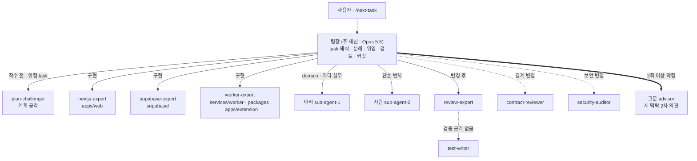

# MULTI_AGENT — 팀으로 개발하기

> Claude Code 세션 하나가 **팀장**이 되어, 작업을 나눠 팀원 에이전트에게 맡기고 결과를 검토합니다.
> 에이전트 정의는 `.claude/agents/`, 분야 규약은 `.claude/skills/`, 명령은 `.claude/commands/`에 있습니다.
> 출처: [tablet-kiosk-core](https://github.com/DevOps0906/tablet-kiosk-core) `docs/11-multi-agent.md`의 멀티에이전트 구조만 옮겨 이 프로젝트에 맞게 고쳤습니다 (7장).
> 모델 구성(사용자 확정): **주에이전트(팀장) Opus 5.5, 부에이전트(팀원 전원) Sonnet 5.5**.

## 1. 구조

- 팀원은 서로를 부르지 않습니다. **모든 호출은 팀장이 중개**합니다 (깊이 1).
- 검증 에이전트는 코드를 고치지 않습니다. 고치는 일은 분야 에이전트에게 돌려보냅니다.
- 리뷰어끼리는 서로의 결과를 보지 않고 각자 판단합니다 (형제 호출).
- 팀원은 모두 Sonnet 5.5 입니다. 팀장(Opus 5.5)이 분해 · 판단 · 최종 검토를 맡고, 같은 모델의 팀원들이 서로 다른 역할과 맥락으로 교차 검증합니다.

## 2. 팀 구성

| 분류 | 에이전트 | 모델 | 쓰기 | 맡는 일 |
|---|---|---|---|---|
| 고문 | `advisor` | `claude-sonnet-5-5` | 없음 | 팀장이 2회 이상 막힌 문제를 새 맥락에서 진단 · 권고 |
| 팀장 | (주 세션) | `claude-opus-5-5` | 전체 | 위임 · 검토 · 커밋 |
| 대리 | `sub-agent-1` | `claude-sonnet-5-5` | 있음 | `packages/domain`, 분야 밖 판단 필요 실무, 문서, 리뷰 지적 반영 |
| 사원 | `sub-agent-2` | `claude-sonnet-5-5` | 있음 | 탐색 · 프로토타입 값 추출 · 시드 정리 · task 파일 변환 · 형식 점검 |
| 분야 | `nextjs-expert` | `claude-sonnet-5-5` | 있음 | `apps/web` 화면 · Route Handler · 디자인 토큰 |
| 분야 | `supabase-expert` | `claude-sonnet-5-5` | 있음 | `supabase/` 마이그레이션 · RLS · RPC · 시드 |
| 분야 | `worker-expert` | `claude-sonnet-5-5` | 있음 | `services/worker` · `packages/{markets,sources,net,compliance}` · `apps/extension` |
| 검증 | `plan-challenger` | `claude-sonnet-5-5` | 없음 | 착수 전 계획 공격 |
| 검증 | `review-expert` | `claude-sonnet-5-5` | 없음 | 변경 후 리뷰 · 추적성 |
| 검증 | `contract-reviewer` | `claude-sonnet-5-5` | 없음 | 경계 계약 대조 |
| 검증 | `security-auditor` | `claude-sonnet-5-5` | 없음 | 보안 심층 감사 |
| 검증 | `test-writer` | `claude-sonnet-5-5` | 테스트만 | 테스트 작성 · 실행 |

키오스크 원본에서 바뀐 모델: `advisor` Fable 5.1 → Sonnet 5.5, `plan-challenger` Opus 5.5 → Sonnet 5.5, `sub-agent-2` Haiku 5.5 → Sonnet 5.5.
올리거나 내리는 방법은 `.claude/agents/README.md` 4장(파일 frontmatter `model:` 한 줄 + 이 표와 README 표 동시 수정 + `/agent-check`).

## 3. 누구에게 맡기나

### 3.1 구현

| 작업 | 담당 |
|---|---|
| `apps/web` 화면 · 셸 · `MarketScope` · 마법사 모달 · Route Handler · 토큰 | nextjs-expert |
| `supabase/` 마이그레이션 · RLS · RPC · 뷰 · 시드 · pgTAP | supabase-expert |
| `services/worker` 잡 · 크론, `packages/markets` 어댑터, `packages/sources` 수집, `packages/net`, `packages/compliance`, `apps/extension` | worker-expert |
| `packages/domain`(마켓 카탈로그 · 수수료 · 가격 공식 · 상태 상수 · GNB · 마법사 점수), 문서 수정, 여러 영역에 걸친 작은 수정, 리뷰 지적 반영 | 대리 |
| 프로토타입에서 문구 · 표 열 · 상태 이름 추출, 시드 정리, 일괄 변환, `06_AGENT_PLAN.md` → `tasks/task-###.md` 변환, 파일 탐색 | 사원 |
| 한 줄 수정 등 위임 비용이 더 큰 일 | 팀장 직접 |

경로별 담당 정본은 `docs/설계/DESIGN_STRUCTURE.md` 7장입니다.
**대리 vs 사원**: 규칙을 한 문장으로 줄 수 있고 결과를 기계적으로 확인할 수 있으면 사원, 기존 동작이 바뀌면 대리.

### 3.2 검증 — 어떤 리뷰를 붙이나

| 상황 | 붙이는 에이전트 | 시점 |
|---|---|---|
| 모든 구현 task | review-expert | 변경 후 |
| 마켓 연동 · 가격 공식 · 동기화 규칙 · 주문/발주 · 결제/크레딧 · DB 스키마 · 인증 | + plan-challenger | 착수 전 |
| 웹 ↔ DB ↔ 워커 ↔ 마켓 어댑터 ↔ 확장프로그램 경계 변경, 상태 값 · 잡 페이로드 변경 | + contract-reviewer | 변경 후 (형제) |
| 마켓 자격증명 · OAuth · 결제/크레딧 · 팀 권한 · 구매자 개인정보 · 확장 토큰 변경 | + security-auditor | 변경 후 (형제) |
| 리뷰가 "검증 근거 없음" | test-writer → review-expert 재실행 | 후행 |

### 3.3 웨이브별 기본 배치

작업 하나하나의 담당 · 착수 전 · 변경 후 배치의 **정본은 `docs/기획서/06_AGENT_PLAN.md` 2장 작업 표**입니다. 아래는 웨이브 단위 기본값입니다(웨이브 정의는 `DESIGN_STRUCTURE.md` 10장).

| 웨이브 | 내용 | 착수 전 | 구현 | 변경 후 |
|---|---|---|---|---|
| W0 기반 | DB 적용 · 앱 골격 · 워커 골격 · 도메인 상수 · 안전 fetch | plan-challenger(DB) | supabase-expert · nextjs-expert · worker-expert · 대리(domain) | review · security(DB) |
| W1 인증 · 도메인 | Mock 로그인 · 세션 · 가격 공식 · 마켓 카탈로그 · 어댑터 인터페이스 | plan-challenger | nextjs-expert · 대리 · worker-expert | review · contract · test-writer(가격 공식) |
| W1-D 디자인 시스템 | 토큰 · 기본 컴포넌트 · 셸 (프로토타입 기준) | — | nextjs-expert (+ 사원: 프로토타입 값 추출) | review |
| W2 수집 | 개별 · 목록 업로드 · 확장프로그램 · 리스크 검사 · 수집함 | plan-challenger(수집 경로) | worker-expert · nextjs-expert | review · security(확장) · contract |
| W3 등록 | 번역 · 가격 · 카테고리 · eBay · Amazon 어댑터 · 개별 · 일괄 등록 | plan-challenger | worker-expert · nextjs-expert · supabase-expert | review · contract · security(OAuth) · test-writer |
| W4 운영 | 동기화 · 주문 · 발주 · 배송 · MarketScope | plan-challenger(동기화 · 발주) | worker-expert · nextjs-expert · supabase-expert | review · contract · test-writer |
| W5 수익 · 계정 · 마법사 | 수익 뷰 · 내 계정 8탭 · 결제 · 마켓 추가 마법사 | plan-challenger(결제 · 권한) | nextjs-expert · supabase-expert · 대리(마법사 점수) | review · security |
| W6 MVP 출시 조건 | E2E · RLS 회귀 · 보안 감사 | — | test-writer | security-auditor 전체 감사 |
| W7 공개 베타 | Google 로그인 · 운영 전환 | plan-challenger | nextjs-expert · supabase-expert | review · security |
| W8 Phase 2 | Shopee · 키워드 수집 · 정기 수집 · 추가 마켓 | plan-challenger | worker-expert · nextjs-expert | review · contract |

## 4. 고문 호출 규칙

1. 팀장이 원인을 다시 분석하고 지시를 고쳐 써도 **같은 문제로 2회 이상 실패**했을 때만 부릅니다.
2. 문제 상황, 시도한 방법과 실패 원인, 관련 파일 경로, 결정할 질문을 정리해 넘깁니다.
3. 고문의 권고는 참고 의견입니다. 최종 결정과 실행 지시는 팀장이 합니다.
4. 고문은 팀원과 같은 Sonnet 5.5 입니다. 가치는 "더 강한 모델"이 아니라 **팀장의 시도에 끌려가지 않는 새 맥락**입니다. 그래도 풀리지 않으면 `advisor.md` 모델을 일시적으로 올리는 것을 사용자에게 제안합니다(`.claude/agents/README.md` 4장).
5. 일상 작업 · 착수 전 검토(plan-challenger 몫)에는 부르지 않습니다.

## 5. 위임 규칙 (팀장)

1. 위임 전 작업을 명확한 단위로 나누고, 범위 · 대상 파일(소유 경로) · 완료 기준 · task 의 "안 할 것"을 지시에 넣습니다.
2. 지시에는 **문서 내용을 붙여 넣지 말고 경로와 장 번호만** 줍니다 (예: `docs/기획서/04_API.md 3장`, `docs/설계/DESIGN_STRUCTURE.md 5.1절`). 팀원이 직접 읽습니다.
3. 사원에게는 규칙과 예시를 함께 줍니다. 규칙이 모호하면 대리에게 넘깁니다.
4. 팀원이 "팀장 확인 필요"로 보고한 사항은 팀장이 결정합니다. 설계와 다르게 가야 하면 루트 CLAUDE.md 2장 5번대로 문서부터 고칩니다.
5. 외부 API 사실(엔드포인트 · 한도 · 서명)은 팀원이 공식 문서 URL 과 함께 보고하게 합니다. "미확인"으로 온 값은 설정으로 남기고 코드 상수로 굳히지 않습니다.
6. 같은 문제로 2회 이상 막히면 팀장이 지시를 다시 쓰고, 사원이 막힌 일은 대리에게 넘깁니다. 그래도 안 되면 고문.
7. 팀원은 commit · push 하지 않습니다. 커밋은 팀장만 합니다.

## 6. 비용 · 토큰 줄이기

| 방법 | 내용 |
|---|---|
| 탐색은 사원에게 | 여러 파일을 훑는 일(특히 큰 `prototype/index.html`)을 사원에게 맡기고 결론만 받습니다 |
| 문서는 필요한 장만 | task 참고 문서를 통째로 읽지 않습니다. 지시에도 장 번호까지 적습니다 |
| 검증은 필요한 만큼 | 3.2 표에 해당할 때만 붙입니다. 같은 리뷰를 반복하지 않습니다 (실패 시만 재실행) |
| task 하나 끝나면 `/clear` | 다음 task 는 새 맥락에서 시작합니다. 진행 상태는 `tasks/README.md`와 커밋에 남아 있습니다 |
| 팀원은 Sonnet | 팀원 전원이 Sonnet 5.5 라 팀장(Opus) 직접 작업보다 싸다. 팀장은 분해 · 판단 · 최종 검토에 집중합니다 |
| 모델 올리기는 일시적으로 | 고문 · 보안 감사를 Opus 로 올렸다면 해당 작업이 끝나면 되돌립니다 |

## 7. 키오스크에서 옮긴 것 · 옮기지 않은 것

| tablet-kiosk-core 구성 | 이 저장소 | 이유 |
|---|---|---|
| 직급형 구조(고문 · 팀장 · 대리 · 사원) | ✅ `advisor` · `sub-agent-1` · `sub-agent-2` · `settings.json` | 사용자 확정 직급 구조 |
| 모델 배치(고문 Fable · 사원 Haiku · 계획 검토 Opus) | 🔁 팀원 전원 Sonnet 5.5 로 변경 | 사용자 지시: 주에이전트 Opus 5.5, 부에이전트 Sonnet 5.5 |
| 운영 원칙 4원칙 | ✅ 루트 `CLAUDE.md` 8장 (`NOTICE`) | 모든 작업에 적용 |
| 검증 에이전트 `plan-challenger` · `review-expert` · `contract-reviewer` · `security-auditor` · `test-writer` | ✅ 마켓 연동 · 금액 · 토큰 · RLS · 수집 경로 기준으로 내용 재작성 | 마켓 계정 · 돈 · 개인정보를 다루는 제품 |
| `nextjs-expert` · `supabase-expert` 에이전트 + 스킬 | ✅ `apps/admin` → `apps/web`, 스키마 `kiosk` → `globalseller`, 매장(`store_id`) → 조직(`org_id`) | 같은 스택 |
| `flutter-expert` 에이전트 + 스킬 | ❌ → ➕ `worker-expert` 새로 만듦 | 이 제품의 중심은 워커 · 마켓 연동 · 수집 경로 |
| 명령 `/next-task` · `/check` · `/agent-check` | ✅ 경로 · 검증 조건 교체, `/agent-check`에 모델 일치 점검 추가 | 같은 작업 방식 |
| 명령 `/sync-design` | 🔁 업종 설계 저장소 대조 → `prototype/index.html` 화면 대조 | 이 제품의 디자인 원본은 프로토타입 |
| `tasks/README.md` + `task-###.md` 진행 방식 | ✅ | 1인 개발에 맞는 가벼운 기록 |
| 키오스크 도메인(VAN 결제 · ESC/POS 출력 · 기기 패키지 · 업종 모듈 · 쿠폰 · 더치페이) | ❌ | 이 제품과 무관 |
| 업종 설계 저장소 `--add-dir` 구성 | 🔁 platform-docs 를 나란히 클론해 공용 코어 문서 참고 (선택) | 공용 코어 원본이 platform-docs 에 있음 |

프레임워크나 키오스크 구성을 고친 뒤 이 저장소에 다시 반영하려면 이 표를 기준으로 ✅ · 🔁 항목만 비교합니다.
