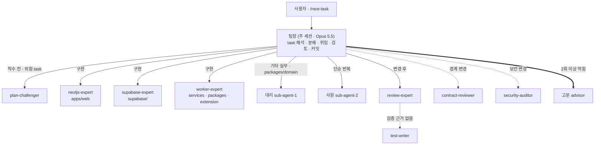

# globalseller-os(GlobalSeller OS) 개발 방법

작성일 2026-10-25. 이 문서는 GlobalSeller OS 기획(`docs/기획서/`)과 디자인 구조(`docs/설계/DESIGN_STRUCTURE.md`)를 실제 코드로 옮기는 방법을 처음부터 끝까지 안내합니다. 형식은 platform-docs `develop/<제품>/<제품>_develop.md`(예: `platform-docs/develop/nomad-commerce/nomad-commerce_develop.md`)를 따르고, 멀티에이전트 운영은 tablet-kiosk-core 구조(`docs/MULTI_AGENT.md`)를 따릅니다. 근거는 `경로:장`으로 적고, 근거가 없는 값은 "제안", 외부 사실 중 원문을 확인하지 못한 것은 "미확인"으로 표시합니다.

## 0. 한눈에 보기

**이 저장소가 곧 개발 폴더입니다.** platform-docs 제품들은 setup 스크립트로 개발 폴더를 따로 만들지만, GlobalSeller OS는 프로토타입·기획서·개발서·코드를 한 저장소에서 관리합니다(tablet-kiosk-core와 같은 방식).

```
작업 폴더/
├── GlobalsellerOS/                 ← 이 저장소 (개발 폴더)
│   ├── CLAUDE.md                   팀장 세션이 항상 먼저 읽는 규칙
│   ├── .claude/                    settings.json(팀장 Opus 5.5), agents/(팀원 Sonnet 5.5), commands/, skills/
│   ├── prototype/                  디자인 원본 (클릭 가능한 HTML, 동결)
│   ├── docs/
│   │   ├── 설계/DESIGN_STRUCTURE.md   화면·라우트·모듈·테이블 이름의 정본
│   │   ├── 기획서/                     README, 01_PRD ~ 08_DESIGN_SYSTEM
│   │   ├── 개발서/                     이 문서
│   │   └── MULTI_AGENT.md             팀 구성·위임·검증 규칙
│   ├── tasks/                      작업 상태표 + task-###.md (06_AGENT_PLAN 사본)
│   ├── supabase/                   마이그레이션, 시드
│   ├── apps/ services/ packages/   ← 코드 (GS-06-001부터 만들어짐)
│   └── tests/
└── platform-docs/                  ← 공용 코어 문서 (읽기 전용, 나란히 클론)
```

| 단계 | 내용 | 장 |
|---|---|---|
| 준비 | 도구 설치, 외부 계정·키 준비 | 2 |
| 1 | 저장소 클론과 폴더 배치 | 3 |
| 2 | 저장소 구조 이해 (아직 코드 없음) | 4 |
| 3 | 로컬 DB 기동과 SQL 적용 | 5 |
| 4 | 착수 전 결정 확정 | 6 |
| 5 | 멀티에이전트 개발 사이클(`/next-task`) | 7 |
| 6 | 웨이브별 진행 | 8 |
| - | 마켓 API 연동, 수집 경로, AI 번역, 디자인 이행, 검증, 위험 | 9~14 |
| - | 체크리스트 | 15 |
| - | 인증 단계(Mock → Google → 카카오·네이버) | 16 |

## 1. 개요

| 항목 | 내용 |
|---|---|
| 제품 | GlobalSeller OS. 쿠팡 상품 수집(개별·대량) → AI 번역·가격 계산 → 해외 마켓 등록(개별·일괄) → 재고·가격 동기화 → 주문·쿠팡 발주·배송 추적 → 수익 분석까지 하는 역직구 운영 도구. 구독 + 크레딧 |
| 디자인 원본 | `prototype/index.html` (2026-10-23 기획 업데이트 반영본). 화면 구조·문구·상태의 기준 |
| 이름 정본 | `docs/설계/DESIGN_STRUCTURE.md` — 화면 S-01~S-11, 라우트, 모듈 경로, 테이블, 상태 값, 큐, API 경로, 금액 규칙 |
| 공용 코어 | platform-docs `products/_platform-core/` (인증·조직·플랜·크레딧·Toss·암호화 자격증명·잡). 코어 SQL은 `supabase/migrations/20261025000001_core_lite.sql`로 복사돼 있다 |
| 이번 개발 방식 | 단독 Supabase 프로젝트 1개(스키마 `globalseller` + 코어 표). 모듈러 통합은 `docs/기획서/README.md` 5장 |
| MVP 범위 | 마켓 eBay US · Amazon US, 수집 경로 URL 개별 · URL 목록 · 확장프로그램 (`DESIGN_STRUCTURE.md` 10장). Shopee는 P1 |
| 멀티에이전트 | 팀장 = 주 세션 `claude-opus-5-5` (`.claude/settings.json`), 팀원 = `.claude/agents/` 전부 `claude-sonnet-5-5` |

이 문서는 "어떻게 시작하고 진행하는가"를 다룹니다. "무엇을 만드는가"는 기획서(`docs/기획서/`)가 정본입니다.

## 2. 사전 준비

### 2.1 도구

| 도구 | 용도 | 확인 명령 |
|---|---|---|
| Git | 저장소 | `git --version` |
| Node.js 22 LTS | 웹 앱, 워커, 확장프로그램 빌드 | `node -v` |
| pnpm (작업 시점 최신 stable) | 모노레포 패키지 관리 | `pnpm -v` |
| Docker Desktop | 로컬 Supabase | `docker info` |
| Supabase CLI | 로컬 DB, 마이그레이션, 타입 생성 | `supabase --version` |
| Chrome | 확장프로그램 개발(압축해제된 확장 로드) | - |
| Claude Code CLI | 팀장 세션과 팀원 에이전트 | `claude --version` |

패키지 버전은 작업 시점에 npm에서 최신 stable과 유지보수 상태를 확인한 뒤 고정합니다. `latest` 태그를 쓰지 않고 lockfile을 커밋합니다.

### 2.2 외부 계정과 키 (사람이 준비)

| 대상 | 필요한 것 | 언제 | 비고 |
|---|---|---|---|
| eBay Developers Program | 개발자 계정, Sandbox·Production 키셋, OAuth 리다이렉트(RuName) | W1 전 | 가입 무료. Production 키셋은 계정 삭제 알림 대응이 필요(9.1절) |
| Amazon Seller Central (US) | Professional 셀러 계정(월 $39.99), 개발자 등록, SP-API 앱(LWA 클라이언트 ID·시크릿) | W3 전 | 여러 셀러가 쓰는 SaaS는 공개 개발자 심사 대상(9.2절). 등록 기간은 수 주 걸릴 수 있다(제안: 가장 먼저 신청) |
| Shopee Open Platform | 파트너 앱(Partner ID·Key), 테스트 상점 | P1 전 | 쇼피코리아 입점 심사와 별개 |
| 쿠팡 파트너스 | 파트너스 가입. API 키는 최종 승인(누적 판매 15만 원 이상) 뒤 발급 | P1 전 | MVP는 키 없이 진행(10장) |
| Toss Payments | 테스트 클라이언트 키·시크릿 키 | W5 전 | 코어 결제 흐름 |
| LLM 제공자 | 번역용 API 키 1개 이상 | W3 전 | 워커 env에만(11장) |
| Google Cloud | OAuth 클라이언트 | W7(Stage B) | 16장 |

## 3. 1단계: 저장소 클론과 폴더 배치

두 저장소를 **같은 상위 폴더에 나란히** 클론합니다. GlobalsellerOS 안에 platform-docs를 클론하지 않습니다.

```bash
mkdir -p ~/work && cd ~/work
git clone https://github.com/DevOps0906/GlobalsellerOS.git
git clone https://github.com/DevOps0906/platform-docs.git
cd GlobalsellerOS
claude --add-dir ../platform-docs
```

| 확인 | 기대 |
|---|---|
| `cat .claude/settings.json` | `{"model": "claude-opus-5-5"}` |
| 팀장 세션에서 `/agent-check` | 팀원 전원 `claude-sonnet-5-5`, 읽기 전용 에이전트에 Write·Edit 없음 |
| `npm test` (프로토타입 스모크) | 39개 항목 모두 통과 |

## 4. 2단계: 저장소 구조 이해

코드 폴더(`apps/`, `services/`, `packages/`)는 아직 없습니다. 첫 작업 GS-06-001이 pnpm 모노레포 골격을 만듭니다. 손으로 미리 만들지 않습니다(소유 경계가 깨집니다).

| 경로 | 내용 | 담당 에이전트 | 정본 |
|---|---|---|---|
| `apps/web/` | Next.js 16 App Router 화면, Route Handler, 디자인 토큰 | `nextjs-expert` | `DESIGN_STRUCTURE.md` 7장 |
| `apps/extension/` | 쿠팡 페이지 수집 크롬 확장(MV3) | `worker-expert` | 10장 |
| `services/worker/` | 잡 런타임, 크론, 큐별 핸들러 | `worker-expert` | `DESIGN_STRUCTURE.md` 9장 |
| `packages/markets/` | `MarketAdapter` 구현(eBay, Amazon SP, Shopee…) | `worker-expert` | `02_ARCHITECTURE.md` |
| `packages/sources/` | 쿠팡 URL 파서, 파트너스 API, CSV·XLSX | `worker-expert` | 10장 |
| `packages/net/`, `packages/compliance/` | 안전 fetch, 리스크 규칙 | `worker-expert` | `02_ARCHITECTURE.md` |
| `packages/domain/` | 마켓 카탈로그, 수수료, 가격 공식, 상태 상수, GNB, 마법사 점수 | `sub-agent-1` | `DESIGN_STRUCTURE.md` 4장·11.3절 |
| `supabase/` | 마이그레이션, 시드, RLS 테스트 | `supabase-expert` | `05_DATA_MODEL.md` |
| `tests/e2e/` | Playwright E2E | `test-writer` | `06_AGENT_PLAN.md` 7장 |

모노레포 이름 규칙(제안): 패키지 이름 `@gs/<폴더>` (예 `@gs/domain`, `@gs/markets`), 앱 이름 `web`, `extension`, `worker`.

## 5. 3단계: 로컬 DB

```bash
supabase start                                # Docker 필요
supabase db reset                             # migrations/ 순서대로 적용 + seed.sql
supabase gen types typescript --local --schema public,globalseller \
  > apps/web/types/supabase.ts                # GS-06-001 이후(경로는 06 작업 정의를 따른다)
```

| 순서 | 파일 | 내용 |
|---|---|---|
| 1 | `supabase/migrations/20261025000001_core_lite.sql` | 공용 코어 lite (platform-docs `MONOLITH_CORE_LITE.sql` 복사, 제휴마케팅 절 제거) |
| 2 | `supabase/migrations/20261025000002_globalseller_domain.sql` | 스키마 `globalseller` 테이블·RLS·뷰·RPC |
| 3 | `supabase/seed.sql` | 앱 레지스트리 `globalseller`, 플랜 3종 |

규칙: 기존 번호 파일은 절대 고치지 않습니다. 변경은 항상 새 번호 파일로 추가합니다(`supabase/README.md`). 원격 `supabase db push`는 사람이 승인한 뒤에만 합니다.

개발용 사용자는 Stage A 시드 스크립트(16장)로 만듭니다. 원격 Supabase URL이면 스크립트가 거부해야 합니다.

## 6. 4단계: 착수 전 결정 확정

결정 대기 항목은 `docs/기획서/01_PRD.md` 8장(열린 결정)이 정본입니다. 웨이브를 시작하기 전에 그 웨이브가 기대는 결정을 사람이 확정하고, 결과를 01장 8장 표에 적은 뒤 커밋합니다.

| 웨이브 | 먼저 확정할 결정 (`01_PRD.md` 8장 번호) |
|---|---|
| W0~W1 | D-01 요금 통화, D-02 Free 플랜, D-12 모놀리스 코어 스키마, D-15~D-17 인증 단계(8.1절) |
| W2 | D-06 확장프로그램 배포 방식, D-07 쿠팡 상세 이미지 정책 |
| W3 | D-05 AI 번역 제공자와 호출 위치, D-08 Amazon SP-API 앱 형태, D-09 eBay 비즈니스 정책, D-10 환율 출처 |
| W4 | D-03 쿠팡 발주 자동화 수준, D-04 배대지, D-11 구매자 개인정보 보관 기간 |
| W5 | D-13 Slack 알림, D-14 세금 처리 범위 |

팀원(서브에이전트)은 사용자에게 질문할 수 없습니다. 결정이 안 된 채 작업이 막히면 팀원은 "팀장 확인 필요"로 보고하고, 팀장이 사용자에게 묻습니다.

## 7. 5단계: 멀티에이전트 개발 사이클

### 7.1 팀 구성 (정본: `docs/MULTI_AGENT.md` 2장)



| 구분 | 모델 | 설정 위치 |
|---|---|---|
| 팀장(주 에이전트) | `claude-opus-5-5` | `.claude/settings.json` |
| 팀원(부 에이전트) 전원 | `claude-sonnet-5-5` | `.claude/agents/*.md` frontmatter `model:` |

팀원끼리 서로 부르지 않고 모든 호출은 팀장이 중개합니다. 커밋은 팀장만 합니다.

### 7.2 한 작업의 흐름 (`/next-task`)

| 순서 | 하는 일 | 누가 |
|---|---|---|
| 1 | `tasks/README.md`에서 상태 `대기`, 선행 `완료`인 가장 앞 번호 선택 | 팀장 |
| 2 | `tasks/task-###.md`와 참고 문서의 **필요한 장만** 읽기 | 팀장 |
| 3 | 계획: 바꿀 파일, 순서, 맡길 에이전트, 확인 방법 | 팀장 |
| 4 | 위험 작업(결제·권한·RLS·마켓 토큰·금액·동기화 반영·주문 상태)이면 계획 공격 | `plan-challenger` |
| 5 | 사용자에게 계획을 보여 주고 승인 | 팀장 |
| 6 | 구현 위임 (경로와 장 번호만 전달, 문서 내용을 붙여 넣지 않음) | 분야 에이전트 / 대리 / 사원 |
| 7 | 리뷰(항상) + 경계·보안 변경이면 형제 리뷰 | `review-expert` (+ `contract-reviewer`, `security-auditor`) |
| 8 | "검증 근거 없음"이면 테스트 작성 후 재리뷰 | `test-writer` → `review-expert` |
| 9 | 완료 조건 확인 → `tasks/README.md` 상태 `완료` → 커밋 `[GS-06-###] 제목` | 팀장 |

같은 문제로 2회 이상 막히면 팀장이 지시를 다시 쓰고, 그래도 안 되면 고문(advisor)에게 새 맥락의 2차 의견을 받습니다. 작업 하나가 끝나면 `/clear`로 맥락을 비우고 다음 작업을 시작합니다(진행 상태는 `tasks/README.md`와 커밋에 남습니다).

### 7.3 요청 프롬프트 예시 (W0 첫 작업)

```
/next-task 001

조건:
- docs/설계/DESIGN_STRUCTURE.md 7장 모듈 경로를 그대로 만든다.
- 원격 Supabase 에 push 하지 않는다.
- 결정이 필요한 것은 묻지 말고 가정을 보고에 적은 뒤 진행하고, 끝에 가정 목록을 표로 보여 준다.
```

## 8. 6단계: 웨이브별 진행

작업 목록과 웨이브의 정본은 `docs/기획서/06_AGENT_PLAN.md` 2~3장입니다. 아래는 흐름 요약입니다.

| 웨이브 | 산출물 | 진입 조건 |
|---|---|---|
| W0 | 모노레포 골격, DB 적용·타입, 도메인 상수, 안전 fetch, 디자인 레퍼런스 | 없음 |
| W1 | 인증 Stage A(Mock), env 검증, RLS 회귀 테스트, `MarketAdapter` 인터페이스 | W0 |
| W1-D | 디자인 시스템 2~4단계(토큰·기본 컴포넌트, 사람 검토, 정답 확정) | W0. **화면 작업의 진입 조건** |
| W2 | 수집: URL 개별, URL 목록 업로드, 확장프로그램, 수집함, 리스크 검사 | W1 |
| W3 | 등록: AI 번역, 가격 계산, eBay·Amazon 어댑터, 개별·일괄 등록 | W2 |
| W4 | 운영: 동기화(규칙·로그·승인), 주문 수집, 발주 기록, 송장·추적 | W3 |
| W5 | 수익 분석, 내 계정 8탭, 마켓 추가 마법사, 결제(Toss) | W4 |
| W6 | E2E, 보안 회귀 → **MVP 출시 조건** | W5 |
| W7 | Google 로그인(Stage B) → **공개 베타 조건** | W6 + 사람의 G1 판정 |
| W8 | Phase 2: Shopee, Amazon JP, Lazada, 키워드·정기 수집, 카카오·네이버 로그인 | 베타 + G2 판정 |

린 검증 권장 순서(제안): W2까지 끝나면 수집함 + 수동 eBay 등록으로 실제 판매 1건을 먼저 만들고, 그 결과로 W3 이후 우선순위를 다시 봅니다(`docs/planning-update-2026-10-23.md` 5장의 MVP 권고).

## 9. 마켓 API 연동 순서

모든 마켓 호출은 `services/worker`에서만 합니다. Route Handler는 OAuth 시작·콜백과 연결 테스트만 합니다(`DESIGN_STRUCTURE.md` 6장).

### 9.1 eBay (P0, 첫 연동)

| 순서 | 할 일 | 비고 |
|---|---|---|
| 1 | Sandbox 키셋으로 OAuth(사용자 동의) → 토큰 저장 → 토큰 갱신 | 토큰은 `encrypted_credentials` |
| 2 | Sandbox에서 리스팅 생성·가격/수량 변경·주문 조회·발송 확인 | `MarketAdapter` 전 메서드 |
| 3 | **계정 삭제 알림 엔드포인트** `/api/webhooks/ebay/account-deletion` 구현 | eBay가 `challenge_code`로 GET을 보내면, challenge code + verification token + 엔드포인트 URL을 순서대로 이어 SHA-256 hex로 `challengeResponse`를 돌려준다. 알림에는 2xx로 응답하고 처리는 비동기로 한다. 대응하지 않으면 키셋이 비활성화될 수 있다([Hookdeck 가이드](https://hookdeck.com/webhooks/platforms/guide-to-ebay-webhooks-features-and-best-practices)) |
| 4 | Production 키셋 발급 → 실계정 1개로 실제 리스팅 1건 | 사람이 판정 |

### 9.2 Amazon US SP-API (P0)

| 항목 | 내용 |
|---|---|
| 인증 | LWA(Login with Amazon) 액세스 토큰. AWS IAM·Signature Version 4 서명은 더 이상 필요하지 않다(Amazon 공식 변경 로그 제목 "SP-API no longer requires AWS IAM or AWS Signature Version 4". 본문 페이지는 열리지 않아 날짜 미확인). **프로토타입 API 키 화면의 "AWS IAM Access Key" 항목은 제품에서 뺀다** |
| 개발자 요금 | 2025-11-03에 발표된 연 $1,400 구독료와 GET 호출 과금은 2026-05-14에 철회됐다("will not move forward … at this time"). 다시 도입될 수 있으므로 W3 착수 시 재확인([PPC Land](https://ppc.land/amazon-drops-sp-api-fees-after-developer-pushback)) |
| 셀러 요금 | Professional 셀러 계정 월 $39.99는 별개로 든다 |
| 공개 개발자 | 여러 셀러가 쓰는 SaaS는 공개(제3자) 개발자 등록·심사 대상. 심사 기간과 요건은 착수 시 공식 문서 확인(미확인) |
| 구매자 개인정보 | 주문 배송지 같은 개인정보는 제한 역할과 별도 토큰이 필요할 수 있다(미확인). 승인 전에는 주문 화면에 배송지 없이 표시하고, 발송은 Seller Central에서 처리하는 대체 흐름을 둔다(제안) |
| 순서 | 앱 등록 → 자기 계정 자가 승인(sandbox) → 리스팅·가격·재고 → 주문 → 발송 확인 → 공개 심사 |

### 9.3 Shopee (P1)

| 항목 | 내용 |
|---|---|
| 인증 | 파트너 키로 요청 HMAC-SHA256 서명 + 상점 권한 승인. 접근 토큰은 4시간마다 갱신(`DESIGN_STRUCTURE.md` 9장 `token_refresh`). 리프레시 토큰 유효 기간은 착수 시 확인(미확인) |
| 순서 | 테스트 파트너로 상점 승인 → SG 리스팅 → TH 리스팅(국가별 가격 개별 계산) → 주문 → SLS 송장 |
| 지원사업 | 쇼피코리아 × 중소벤처기업진흥공단 판매 지원사업(2025년 공고 기준)은 매년 공고를 확인한다 |

### 9.4 공통 규칙

| 규칙 | 내용 |
|---|---|
| 멱등 | 리스팅 전송·가격 변경·발송 확인마다 멱등 키(`listing:<id>:<version>` 등, 제안)를 붙이고 재시도해도 중복 등록이 없어야 한다 |
| 레이트 리밋 | 429·쓰로틀 응답은 지수 백오프. 마켓별 한도는 어댑터 상수로 두고 작업 시점 공식 문서로 확인 |
| 토큰 만료 | 만료되면 계정 상태 `token_expired`, 화면 마켓 탭에 "재연결" 표시(S-04 Shopee 예시와 같음) |
| 테스트 | 실제 마켓 호출 테스트는 Sandbox 키만. CI에서는 어댑터 목(mock) 응답을 쓴다 |

## 10. 수집 경로 구축

| 경로 | 우선순위 | 구현 | 제약 |
|---|---|---|---|
| URL 개별 | P0 | `packages/sources` URL 파서 → 워커 수집 잡 | 서버가 쿠팡 페이지를 대량으로 긁지 않는다(약관). 사용자가 넣은 URL 단건만 |
| URL 목록 업로드 | P0 | CSV·XLSX 업로드 → 줄마다 수집 잡 | 1회 최대 줄 수는 플랜 한도(01장 4장) |
| 확장프로그램 | P0 | `apps/extension` MV3: 사용자가 보고 있는 쿠팡 페이지·검색 결과에서 체크한 상품을 `/api/extension/items`로 전송 | 확장 토큰은 단기 토큰(`/api/extension/token`). 사용자 화면에서 읽은 값만 보낸다 |
| 키워드 (파트너스 API) | P1 | `packages/sources` 파트너스 클라이언트 | 최종 승인 뒤 키 발급, 키워드 검색만(가격 필터 무시 보고), 호출 제한(공식 분당 50회 / 실사용 보고 시간당 10회로 엇갈림 → 화면에는 보수적으로 표시). 초과 반복 시 계정 제한 위험 |
| 정기 수집 | P1 | `collect_presets` 일정 → 크론 | 키워드 수집과 같은 제약 |

확장프로그램 개발: `pnpm -F extension build` 후 Chrome `chrome://extensions` → 개발자 모드 → "압축해제된 확장 프로그램을 로드합니다"로 `apps/extension/dist`를 엽니다. 배포 방식(비공개·웹스토어)은 6장 결정 사항입니다.

수집 직후에는 항상 리스크 검사(`packages/compliance`: 항공 제한, 브랜드 판매 제한, 제외 키워드, 이미지 사용 권한)를 거치고, 대량 수집 통과 상품도 기본은 수집함에 보관합니다. 자동 등록은 사용자가 켠 경우에만입니다(`docs/planning-update-2026-10-23.md` 4장).

## 11. AI 번역 계층

| 항목 | 규칙 |
|---|---|
| 호출 위치 | `services/worker/src/translate/` 에서만. LLM 키는 워커 env에만 두고 `apps/web`·브라우저·확장에 두지 않는다 |
| 기능 | 상품명(마켓별 길이 제한), 특징 5개, 설명, 검색 키워드, 일본어(P2) |
| 크레딧 | Route Handler가 선차감 → 잡 → 실패 시 환불(코어 `CORE_SPEC.md` 4.3절 순서). 단가는 `01_PRD.md` 4장 |
| 금지 출력 | 효능·의학적 단정, 가짜 후기·평점, 원산지·브랜드 허위 표기. 출력은 zod로 다시 검증 |
| 평가셋 | 상품 20건(뷰티·식품·리빙) 번역 결과를 사람이 1회 판정해 기준으로 고정(제안) |
| 플랫폼 AI 계층 | platform-docs `_platform-core/AI_ARCHITECTURE.md`(FastAPI ai-service)로 옮길지는 열린 결정 D-05(`01_PRD.md` 8장). MVP 권고는 워커 직접 호출 |

## 12. 디자인: 프로토타입 → 디자인 시스템

| 순서 | 할 일 | 정본 |
|---|---|---|
| 1 | 프로토타입 CSS 토큰(OKLCH 브랜드·상태·차트, 중립색, 마켓 고유색, 반경, 그림자, 서체)을 Tailwind CSS v4 `@theme`으로 옮긴다 | `docs/기획서/08_DESIGN_SYSTEM.md` 3장 |
| 2 | 기본 컴포넌트(shadcn/ui 재스타일)와 제품 컴포넌트(KPI 카드, `MarketScope`, 지표 띠, 세그먼트 탭, 선택 카드, 추천 카드, 마법사 모달) | 08장 마지막 장, `07_SOURCE_MIGRATION.md` 2장 매핑표 |
| 3 | 사람이 비주얼을 검토하고 수치를 확정(W1-D 사람 작업) | `06_AGENT_PLAN.md` |
| 4 | 화면 구현 후 `/sync-design S-0x`로 프로토타입과 차이 점검 | `.claude/commands/sync-design.md` |

반응형 3구간(모바일 ~767 · 태블릿 768~1199 · 데스크탑 1200~)과 구간별 글자 크기는 `DESIGN_STRUCTURE.md` 2장 표를 따릅니다. Tailwind는 반드시 v4 문법(`@import "tailwindcss"`, `@theme`)만 쓰고 `tailwind.config.js`를 만들지 않습니다.

## 13. 검증과 완료 정의

| 검사 | 명령 | 언제 |
|---|---|---|
| 정적 분석·테스트 요약 | `/check` | 작업마다 |
| 웹·워커 | `pnpm -r lint`, `pnpm -r typecheck`, `pnpm -r test`, `pnpm -F web build` | 작업마다 |
| DB | `supabase db reset`, `supabase test db` | DB 작업 |
| RLS 회귀 | `supabase/tests/` (06 작업) | DB·권한 변경 |
| E2E | `pnpm test:e2e` (Playwright) | W6, 화면 변경 |
| 프로토타입 스모크 | `npm test` (`tests/prototype-smoke.js`) | 프로토타입 변경 시 |
| 디자인 대조 | `/sync-design <화면 ID>` | 화면 작업 |
| 팀 구성 | `/agent-check` | 에이전트 파일 변경 시 |

완료 정의 정본은 `docs/기획서/06_AGENT_PLAN.md` 7장입니다. 리뷰 판정이 `UNKNOWN`(검증 근거 없음)이면 완료로 치지 않습니다.

## 14. 위험과 주의

| 위험 | 영향 | 대응 |
|---|---|---|
| Amazon 공개 개발자 심사 지연 | Amazon 연동 일정 | eBay를 먼저 끝내고 판매 검증. Amazon은 W3 시작 전에 신청 |
| SP-API 요금 재도입 | 원가 | 9.2절 재확인, 요금 발생 시 플랜 가격 재계산 |
| 쿠팡 약관·이미지 권리 | 법적 위험, 계정 제재 | 서버 대량 크롤링 금지, 사용자 주도 수집만, 상세 이미지 재사용 경고(리스크 검사) |
| 파트너스 API 제한 | 키워드 수집 품질 | MVP에서 빼고 URL·확장 경로 우선 |
| 동기화 오반영(가격 급락·오인식) | 손실 판매 | 최소 마진 미달 변경은 `held`(승인 대기), 최저·최고가 보호 |
| 주문·발주 중복 | 이중 구매 | 주문별 발주 1건 제약, 멱등 키 |
| 구매자 개인정보 | 법적 위험 | 보관 기간(01장 6장) 후 마스킹, 로그에 주소 금지 |
| 환율 급변 | 마진 붕괴 | 1시간 갱신, ±2% 변동 시 재계산 규칙, 실패 시 직전 값 유지 |
| 마켓 정책 변경(수수료·필수 속성) | 등록 실패 | 마켓 카탈로그·수수료는 `packages/domain` 한 곳, 변경 시 문서 먼저 |

## 15. 체크리스트

| 시점 | 확인 |
|---|---|
| 시작 전 | 두 저장소 나란히 클론, `/agent-check` 통과, `npm test` 통과, 외부 계정 신청 상태 확인(2.2절) |
| W0 끝 | `supabase db reset` 오류 0, 타입 생성, `pnpm -r build` 통과 |
| W1-D 끝 | 디자인 토큰·기본 컴포넌트 사람 승인, `tailwind.config.js` 0개 |
| W2 끝 | URL 1건·목록 100줄·확장 담기 50건 수집, 리스크 검사 결과 표시 |
| W3 끝 | eBay Sandbox 개별·일괄 등록, 판매가 계산이 `packages/domain/pricing.ts`와 화면에서 같음 |
| W4 끝 | 동기화 승인 흐름, 주문 → 발주 → 송장 → 추적 한 바퀴 |
| W6 끝 | E2E·보안 회귀 통과, MVP 출시 조건 충족 |
| W7 끝 | Google 로그인, 공개 베타 |

## 16. 인증 단계: Mock → Google → 카카오·네이버

정본은 platform-docs `products/_platform-core/AUTH_ROADMAP.md`이고, 이 제품의 적용은 `docs/기획서/02_ARCHITECTURE.md` 인증 단계 장과 `06_AGENT_PLAN.md` 인증 단계 작업이 정합니다.

| 단계 | 내용 | 시점 |
|---|---|---|
| Stage A | 로컬 시드 계정 Mock 로그인(`/api/dev/login`, 화면 상단 `MOCK AUTH · 로컬 전용` 배지). 운영 빌드에서 Mock이 켜지면 빌드 실패 | MVP 개발 전체 |
| G1 | 사람이 판정: MVP 출시 조건 충족, 보안 회귀 통과 | W6 뒤 |
| Stage B | Google OAuth + 이메일 가입·초대 메일 | W7, 공개 베타 전 |
| G2 | 사람이 판정: 베타 운영 안정 | 베타 뒤 |
| Stage C | 카카오(C1)·네이버(C2) | W8 |

개발용 페르소나는 `05_DATA_MODEL.md` 시드 장을 따릅니다(owner, manager, viewer, outsider 등). 시드 스크립트는 원격 Supabase URL이면 종료 코드 1로 거부합니다.

## 부록 A. platform-docs에 등록할 때

GlobalSeller OS를 platform-docs의 17번째 제품으로 올리려면 아래만 옮깁니다. 코드는 옮기지 않습니다.

| 이 저장소 | platform-docs |
|---|---|
| `docs/기획서/README.md`, `01~08`, `CLAUDE.md` | `products/globalseller-os/` |
| `supabase/migrations/20261025000002_globalseller_domain.sql` | `products/globalseller-os/supabase/monolith/migrations/0002_globalseller_domain.sql`, 모듈러 조각 `products/_supabase-modular/migrations/2700_globalseller.sql`(접두사 변환) |
| `docs/개발서/globalseller-os_develop.md` | `develop/globalseller-os/globalseller-os_develop.md` |
| 인덱스 | `products/README.md`, `develop/README.md` 제품 표에 1행 |

## 출처

| 내용 | 출처 |
|---|---|
| 문서 형식 | platform-docs `develop/nomad-commerce/nomad-commerce_develop.md`, `products/_platform-core/DOC_TEMPLATE.md` |
| 멀티에이전트 구조 | tablet-kiosk-core `docs/11-multi-agent.md`, `.claude/` |
| SP-API 요금 철회 | [Amazon drops SP-API fees after developer pushback (PPC Land)](https://ppc.land/amazon-drops-sp-api-fees-after-developer-pushback) |
| SP-API IAM·SigV4 불필요 | [SP-API no longer requires AWS IAM or AWS Signature Version 4 (Amazon 변경 로그)](https://developer-docs.amazon.com/sp-api/changelog/sp-api-will-no-longer-require-aws-iam-or-aws-signature-version-4) — 제목만 확인 |
| eBay 계정 삭제 알림 | [Guide to eBay Webhooks (Hookdeck)](https://hookdeck.com/webhooks/platforms/guide-to-ebay-webhooks-features-and-best-practices) |
| 쿠팡 파트너스 API 제약 | `docs/planning-update-2026-10-23.md` 5장과 그 출처 |
