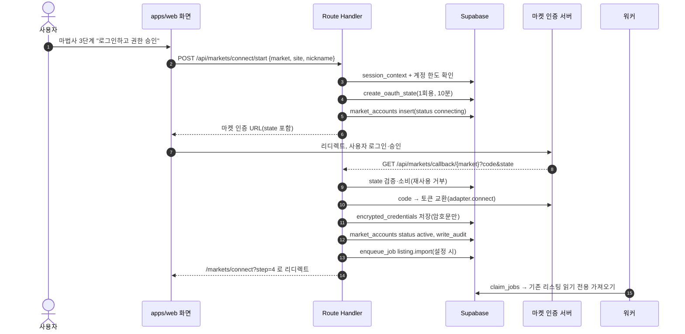
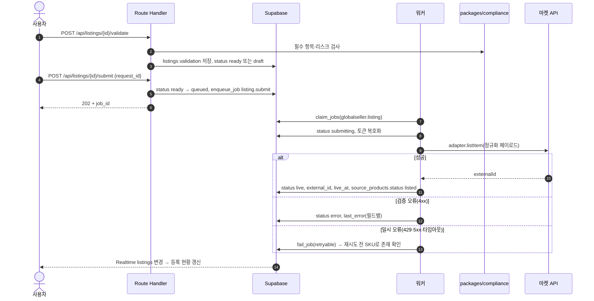

# 02 아키텍처: GlobalSeller OS

작성일 2026-10-25. 전체 구성도는 `docs/설계/DESIGN_STRUCTURE.md` 6장, 모듈 그림은 같은 문서 7장이 정본이고 이 문서는 그 그림을 표로 풀어 쓴다. 근거는 `경로:줄`, 근거가 없는 수치는 "제안", 확인하지 않은 외부 사실은 "미확인"으로 표시한다.

## 1. 스택

| 레이어 | 기술 | 버전 | 근거 |
|---|---|---|---|
| 웹 앱(화면·Route Handler) | Next.js App Router, React, TypeScript | Next.js 16.x, React 19.x, TypeScript 5.x (작업 시작 시 최신 stable로 고정) | platform-docs 공용 스택(`products/nomad-commerce/CLAUDE.md` 5장), 사용자 기본 스택 |
| 스타일 | Tailwind CSS v4, shadcn/ui(Tailwind CSS v4 지원 버전) | Tailwind CSS 4.x | `_design-guide/DESIGN_SYSTEM.md` 6장. `tailwind.config.js` 금지, `@theme` 토큰만 |
| DB·인증·실시간·파일 | Supabase(Postgres 15+, Auth, Realtime, Storage). 코어 표는 `public`, 도메인은 `globalseller` 스키마 | 호스티드 | `supabase/README.md` 1장, 01_PRD D-12 (a) |
| 공용 코어 | platform-docs `MONOLITH_CORE_LITE.sql` 사본(affiliate 제거) | 2026-10-25 사본 | `supabase/migrations/20261025000001_core_lite.sql:1-8` |
| 잡 워커 | Node.js, TypeScript, `pg`/supabase-js(service_role) | Node 22 LTS | 코어 잡 계약 `CORE_SPEC.md` 9장(SKIP LOCKED) |
| 수집 확장프로그램 | Chrome Extension Manifest V3, TypeScript | MV3 | 개별·대량 수집 경로(`docs/planning-update-2026-10-23.md` 5장) |
| AI(번역·제목·카테고리) | 워커에서 LLM HTTP 호출, 체인은 코어 `resolve_ai_route` | 제공자 SDK 최신 stable | 5장. platform-docs 기본(FastAPI ai-service)과 다름 → 01_PRD D-05 (a) |
| 결제 | Toss Payments(코어 SECTION 3) | API v1 | `20261025000001_core_lite.sql:1103` |
| 테스트 | Vitest(단위), Playwright(E2E), PGlite·로컬 Supabase(RLS) | 최신 stable | 06_AGENT_PLAN 7장 |
| 패키지 관리 | pnpm workspace | pnpm 9.x | 제안 |

스택을 적을 때는 항상 "Tailwind CSS v4"라고 쓴다. 3D 히어로, FastAPI, Dify, 음성은 MVP 범위가 아니다(01_PRD 2장).

## 2. 모듈 경계

| 모듈 | 경로 | 하는 일 | 하지 않는 일 | 담당 에이전트 |
|---|---|---|---|---|
| 웹 앱 | `apps/web/` | 화면 S-01~S-11, Route Handler(`app/api/*`), 세션, 디자인 토큰(`styles/tokens.css`) | 마켓 API·쿠팡·LLM 호출(연결 테스트·OAuth 코드 교환 제외), 토큰 복호화 | `nextjs-expert` |
| 인증 | `apps/web/lib/auth/`, `app/(auth)/login/`, `app/auth/callback/`, `app/api/dev/login/` | 단계별 로그인(9장). `AUTH_MODE`를 읽는 코드는 이 경로에만 | 기능 코드·워커의 `if (mock)` 분기 | `nextjs-expert` |
| 확장프로그램 | `apps/extension/` | 쿠팡 상품·검색 결과 페이지에서 사용자가 고른 상품 정보를 `/api/extension/items`로 보냄 | 자동 순회·백그라운드 크롤링, 쿠팡 로그인 정보 접근 | `worker-expert` |
| 워커 런타임 | `services/worker/src/runtime/`, `src/cron/` | 잡 claim 루프, 핸들러 자동 로드(`src/<영역>/handler.ts`), 크론, 하트비트 | 화면 로직 | `worker-expert` |
| 워커 핸들러 | `services/worker/src/{collect,translate,listing,listing-import,sync,orders,shipping}/` | DESIGN_STRUCTURE 9장 큐 처리 | 다른 영역 핸들러 수정 | `worker-expert` |
| 마켓 어댑터 | `packages/markets/{ebay,amazon-sp,shopee,lazada,qoo10}/` | `MarketAdapter` 구현(4장 4.2) | DB 접근(호출자가 넘긴 값만 씀) | `worker-expert` |
| 원본 소스 | `packages/sources/{coupang-url,coupang-partners,file-import}/` | 쿠팡 URL 파싱과 사용자가 준 URL 단건 조회(`packages/net` 경유, 요청 간격 1초 이상, 목록 업로드도 줄마다 단건), 파트너스 검색 API(P1), CSV·XLSX 파서 | 검색·카테고리 페이지 순회 같은 대량·자동 크롤링(01_PRD 6장) | `worker-expert` |
| 안전 fetch | `packages/net/` | 허용 도메인, DNS 후 사설 IP 차단, 리다이렉트 3회, 응답 5MB, 15초(제안) | 사용자 URL 직접 fetch 우회 | `worker-expert` |
| 리스크 규칙 | `packages/compliance/` | 항공 제한, 브랜드 판매 제한, 금지어, 이미지 권한, 마켓별 필수 항목 검사 | 판정 결과 저장(호출자 몫) | `worker-expert` |
| 도메인 상수 | `packages/domain/` | 마켓 카탈로그, 수수료표, `pricing.ts`(가격 공식 단일 소스), 상태 상수, GNB, `readiness.ts`(마법사 점수), zod 스키마 | 외부 호출 | `sub-agent-1` |
| DB | `supabase/` | 마이그레이션, seed, RLS 테스트(`supabase/tests/`) | 기존 번호 파일 수정 | `supabase-expert` |

의존 방향: `apps/*` → `packages/*`, `services/worker` → `packages/*`. `packages/*`끼리는 `markets`·`sources` → `net`, 그 밖에는 `domain`만 참조한다. 순환 참조가 생기면 빌드를 실패시킨다(제안: `dependency-cruiser`).

## 3. 공용 모듈 사용

| 공용 모듈(코어) | 용도 | 호출 위치 | 비고 |
|---|---|---|---|
| 신원·조직·세션 `session_context` | 화면·Route Handler 진입 시 조직·역할·엔타이틀먼트 확인 | `apps/web/lib/session/` | 요청당 1회(`20261025000001_core_lite.sql` SECTION 2) |
| 멤버 관리 `invite_member` 등 | S-10 팀 멤버 탭 | Route Handler | 코어 함수 그대로 |
| 플랜·구독·엔타이틀먼트 | 한도 판정 `globalseller.features`/`plan_limit` | DB 트리거, Route Handler | `20261025000002_globalseller_domain.sql:26-52` |
| Toss 결제 | 구독·크레딧팩 | `app/api/billing/*`, `/api/webhooks/toss` | 코어 SECTION 3 |
| 크레딧 `consume_credits`/`refund_credits` | AI 번역 선차감·환불 | Route Handler(개별·일괄), 워커(수집 후 번역) | 멱등 키 4장 4.3 |
| OAuth state `oauth_states` | 마켓 OAuth 연결의 1회용 nonce | `/api/markets/connect/start`, `/api/markets/callback/[market]` | 코어 SECTION 6-A |
| 암호화 자격증명 `encrypted_credentials` | 마켓 토큰, API 키, 쿠팡 파트너스 키, Slack 웹훅 | 저장: Route Handler / 복호화: 워커만 | AES-256-GCM, 코어 SECTION 6-B |
| 레이트 리밋 `rate_limit_buckets` | 공개·고비용 Route Handler 보호, 마켓별 호출 버킷 | Route Handler, 워커 | 코어 SECTION 6-C |
| 잡 `jobs` | 모든 비동기 작업 | `enqueue_job`(Route Handler·RPC), `claim_jobs`(워커) | 코어 SECTION 7, 실패 시 자동 환불 |
| Storage `org-files`, `exports` | 업로드한 URL 목록 파일, 내보내기 | 서명 업로드 URL | 경로 `<org_id>/globalseller/<entity>/<uuid>.<ext>` |
| 감사 `write_audit` | 마켓 연결·해제, 발주 기록, 승인, 결제 | RPC, Route Handler | 코어 SECTION 5-A |
| AI 라우팅 `resolve_ai_route`, `ai_usage` | 번역 체인 선택과 사용량 기록 | 워커 | 코어 SECTION 11, seed `supabase/seed.sql:53-60` |

코어 함수를 재정의하거나 `public` 코어 표를 ALTER하지 않는다.

## 4. 잡과 워커

### 4.1 잡 타입

| `job_type` | 큐 | 런타임 | 크레딧 선차감 | 재시도 | 환불 조건 |
|---|---|---|---|---|---|
| `collect.url`, `collect.url_list`, `collect.extension` | `globalseller.collect` | TS 워커 | 없음(수집 무료, 상품 한도만) | 3회, 지수 백오프 | 해당 없음 |
| `collect.keyword`, `collect.schedule` | `globalseller.collect` | TS 워커 | 없음 | 3회. 파트너스 403이면 재시도 안 함 | 해당 없음 |
| `translate.listing` | `globalseller.translate` | TS 워커 | 리스팅 1개 × 언어 1개 = 1크레딧 | 3회(제공자 체인 내 대체 포함) | 최종 실패 시 전액(코어 `fail_job` 자동 환불) |
| `listing.submit` | `globalseller.listing` | TS 워커 | 없음 | 3회. 4xx 검증 오류는 재시도 안 함 → `listings.status=error` | 해당 없음 |
| `listing.import` | `globalseller.listing_import` | TS 워커 | 없음 | 3회 | 해당 없음 |
| `sync.check_sources`, `sync.apply_event` | `globalseller.sync` | TS 워커 | 없음 | 3회 | 해당 없음 |
| `orders.import`, `orders.confirm_shipment` | `globalseller.orders_import` | TS 워커 | 없음 | 5회(주문 누락 방지) | 해당 없음 |
| `shipping.track`, `shipping.upload_tracking` | `globalseller.tracking` | TS 워커 | 없음 | 5회 | 해당 없음 |

페이로드 스키마는 04_API 4장. 큐 이름과 핸들러 경로는 `docs/설계/DESIGN_STRUCTURE.md` 9장과 같다.

### 4.2 마켓 어댑터 인터페이스 (`packages/markets/types.ts`)

| 메서드 | 입력 | 출력 | 호출 위치 |
|---|---|---|---|
| `connect` | OAuth 코드 또는 API 키, 사이트 | `{ externalAccountId, tokens, scopes, expiresAt }` | `/api/markets/callback/[market]`, `/api/markets/accounts` |
| `refresh` | 리프레시 토큰 | 새 토큰, 만료 시각 | 워커 `token_refresh` 크론 |
| `listItem` | 정규화 리스팅(`ListingPayload`: sku, title, bullets, description, images, price_minor, currency, quantity, category_id, attributes) | `{ externalId, status }` 또는 필드별 오류 | 워커 `listing.submit` |
| `updatePriceQty` | `[{ externalId, sku, price_minor?, quantity? }]` 최대 50건 | 건별 성공·실패 | 워커 `sync.apply_event` |
| `fetchOrders` | `since`(커서) | 정규화 주문(`MarketOrder`)과 다음 커서 | 워커 `orders.import` |
| `confirmShipment` | 주문 id, 운송사, 송장 | 성공·실패 | 워커 `orders.confirm_shipment`, `shipping.upload_tracking` |
| `health` | 없음 | 지표 맵(`market_health_snapshots.metrics` 키) | 워커 `health` 크론 |
| `importListings` | 커서 | 기존 리스팅 목록(읽기 전용) | 워커 `listing.import` |

모든 메서드는 `AbortSignal.timeout`(제안 20초)과 zod 응답 검증을 쓴다. 어댑터는 DB를 읽거나 쓰지 않고 토큰을 넘겨받기만 한다.

### 4.3 마켓별 인증과 호출 규칙

| 마켓 | 인증 | 토큰 수명 | 서명·헤더 | 레이트 리밋 대응 | 우선순위 |
|---|---|---|---|---|---|
| eBay US | OAuth 2.0 authorization code(RuName 리디렉트) | 액세스 약 2시간, 리프레시 약 18개월(미확인) | `Authorization: Bearer` | API별 일일 호출 한도(미확인) → 계정별 버킷, 429 시 다음 주기로 | P0 |
| Amazon US | Login with Amazon(LWA) 판매자 앱 승인(Seller Central website authorization) + SP-API | LWA 액세스 1시간, 리프레시 장기(미확인) | `x-amz-access-token`. AWS IAM·SigV4 서명은 필요 없음(Amazon 변경 로그 "SP-API no longer requires AWS IAM or AWS Signature Version 4", 개발서 9.2절). 개발자 연 구독료·호출 과금은 2026-05-14 철회(개발서 9.2절) | 작업별 rate·burst 토큰 버킷, 응답 `x-amzn-RateLimit-Limit` 존중 | P0 |
| Shopee SG·TH | Open Platform v2 상점 승인 링크 → code → token | 액세스 4시간, 리프레시 30일(미확인) | `partner_id`·`timestamp`·`sign`(HMAC-SHA256: partner_id+path+timestamp+access_token+shop_id) | 4시간마다 토큰 재발급 크론, 국가별 shop_id | P1 |
| Lazada | Open Platform OAuth + App Key 서명(HMAC-SHA256) | 미확인 | `sign` 파라미터 | 미확인 | P2 |
| Qoo10 JP | QSM API 키(사용자 입력) | 키 만료 없음(미확인) | 키 헤더 | 미확인 | P2 |
| 쿠팡 파트너스(원본) | Access Key·Secret Key, HMAC 서명 | 만료 없음 | `Authorization: CEA ...`(미확인) | 검색 API 호출 제한(공식 분당 50회와 실사용 시간당 10회 보고가 다름) → 보수적으로 시간당 10회 버킷, 403 3회면 키 일시 중지 | P1 |

외부 사실 출처는 `docs/planning-update-2026-10-23.md` 5장과 출처 목록. "미확인" 값은 각 어댑터 작업(GS-06-024 eBay, GS-06-025 Amazon, GS-06-051 Shopee, GS-06-053 Lazada)을 시작할 때 공식 문서로 확인하고 이 표를 고친다.

### 4.4 멱등과 재시도

| 대상 | 멱등 키 | 효과 |
|---|---|---|
| 수집 잡 | `job:globalseller:collect:<request_id>` | 같은 요청 2회 → 잡 1개(`20261025000002_globalseller_domain.sql:877-932`) |
| 번역 크레딧 | `consume:globalseller:translate:<listing_id>:<lang>:<content_version>` | 재시도 시 원장 1행 |
| 일괄 등록 실행 | `consume:globalseller:batch:<batch_id>` + 항목별 `job:globalseller:listing:<listing_id>:<attempt>` | 실패 항목만 부분 환불 |
| 마켓 전송 | 마켓 SKU(`listings.sku`) 기준 upsert. 응답 유실 시 재시도 전에 `GET by sku`로 존재 확인 | 중복 리스팅 0 |
| 주문 수집 | `(market_account_id, external_order_id)` 유일 | 같은 주문 1행 |
| 승인 반영 | `job:globalseller:sync_approve:<event_id>` | 두 번 눌러도 1회 |

### 4.5 크론 (워커 `src/cron/`)

DESIGN_STRUCTURE 9장 표가 정본이다. 크론은 조직별 잡을 만들 뿐 직접 마켓을 호출하지 않는다. 동시성은 조직당 큐별 2개(제안), 마켓 계정당 1개로 묶어 레이트 리밋을 넘지 않게 한다.

## 5. AI 라우팅

| feature (`ai_routing_settings.feature`) | kind | 모드 | 대체 체인(seed) | 크레딧 | 입력에서 빼는 것 |
|---|---|---|---|---|---|
| `globalseller.translate` | llm | auto | openai → google → anthropic → oss-llm | 리스팅·언어당 1 | 판매자 연락처, 마켓 토큰, 구매자 정보 |
| `globalseller.title` | llm | auto | anthropic → openai → oss-llm | 번역에 포함(별도 차감 없음) | 같음 |
| `globalseller.category_map` | llm | auto | google → openai → oss-llm | 0(제안) | 같음 |
| `globalseller.review_summary` | llm | auto | oss-llm → google | 0(제안) | 리뷰 작성자 이름 |

| 규칙 | 내용 |
|---|---|
| 호출 위치 | 워커 `src/translate/`만. 브라우저·Route Handler는 잡만 만든다 |
| 키 위치 | LLM 제공자 키는 워커 env에만. Vercel(웹) env에 두지 않는다 |
| 체인 | 코드에 제공자·모델을 하드코딩하지 않는다. `resolve_ai_route(org, 'globalseller', feature, 'llm')` 결과만 쓰고 사용량은 `ai_usage`에 남긴다 |
| 국외 이전 | `set_ai_cross_border_ack` 미동의 조직은 오픈소스 체인만(코어 SECTION 11) |
| 출력 검증 | zod 스키마(`packages/domain/schema/translation.ts`): 제목 200자, 특징 5개, 금지 문형(효능 단정, 가짜 후기) 검사 후 저장 |
| platform 기본과의 차이 | platform-docs는 LLM 호출을 FastAPI ai-service로 모은다. MVP는 워커 직결로 단순화한다(01_PRD D-05 (a)). platform-docs 모듈러로 옮길 때 ai-service 경유(D-05 (b))로 바꾼다 |

이미지 처리(흰 배경 변환)는 Phase 2이며 이 체인 밖이다.

## 6. 리뷰 "높음" 결함의 차단 설계

신설 제품이라 원본 코드 리뷰(`docs/reviews/`)가 없다. 대신 같은 도메인 원본인 nomad-commerce의 "높음" 결함 중 이 제품에 다시 생길 수 있는 비보안 항목을 막는다(보안·데이터 항목은 05_DATA_MODEL 7장).

| 출처 | 결함 요약 | 차단 설계 | 담당 장/작업 |
|---|---|---|---|
| `products/nomad-commerce/CLAUDE.md` 7장(`globalThis` 잡) | 프로세스 메모리 잡 큐 → 재시작 시 유실 | 코어 `jobs` + SKIP LOCKED만 쓴다 | 4장, GS-06-010 |
| 같은 문서(SSE + 브라우저 큐) | 브라우저가 작업 순서를 들고 있어 창을 닫으면 중단 | 일괄 등록은 서버 대기열, 화면은 Realtime 구독만 | 4.1, GS-06-027 · GS-06-028 |
| 같은 문서(LLM 추정 환율) | LLM이 환율을 추정 | `fx_rates` 크론 값만, 실패 시 직전 값 유지 | 4.5, GS-06-010(`src/cron/fx.ts`) |
| 같은 문서(mock 응답으로 장애 숨김) | 외부 API 실패를 가짜 성공으로 바꿈 | 어댑터 실패는 `last_error` + 화면 상태, 가짜 데이터 금지 | 4.2 |
| 같은 문서(env 단일 마켓 키) | 마켓 키 1개를 env에 둬 다계정 불가 | 계정별 `encrypted_credentials` | 3장 |
| 같은 문서(클라이언트 한도 판단) | 플랜 한도를 브라우저에서 판단 | DB 트리거(`source_products_enforce_quota`, `market_accounts_enforce_quota`) | 05장 |
| 쿠팡 파트너스 운영 위험(`docs/planning-update-2026-10-23.md` 5장) | 호출 한도 초과 반복 시 계정 제한 | 시간당 버킷 + 403 3회 중지 + 키워드 수집은 P1 | 4.3, GS-06-054(P1) |
| 쿠팡 Wing 초당 제한(같은 문서 5장) | 초당 호출 초과 429 | 조직·계정 단위 직렬 대기열 | 4.5 |
| 대량 자동 등록 지재권 신고(같은 문서 4장) | 검증 없이 대량 등록 | 리스크 검사 `block`이면 `ready` 불가(DB check `listings_no_block_submit_check`) | 05장, GS-06-013 |

## 7. 배포 토폴로지

| 구성 | 위치 | 네트워크 경계 |
|---|---|---|
| 웹 앱 `apps/web` | Vercel(서울 리전 icn1, 제안) | 공개 HTTPS. 서버 env에만 service_role·암호화 키 |
| 워커 `services/worker` | Railway 또는 Fly.io 컨테이너 1~2개(제안) | 아웃바운드만(마켓·쿠팡·LLM·운송사). 인바운드 없음, 헬스체크 포트만 |
| Supabase | 호스티드 프로젝트 1개(서울 ap-northeast-2, 제안) | 웹·워커가 service_role로 접속. 브라우저는 anon 키 + RLS |
| 확장프로그램 | Chrome 웹 스토어(비공개 배포로 시작, 제안) | `/api/extension/*`만 호출, 확장 토큰(24시간) |
| 외부 콘솔 | eBay Developer, Amazon Seller Central 개발자 앱, Shopee Open Platform, Toss | 리디렉트 URI = `https://<도메인>/api/markets/callback/<market>` |

배포 순서는 DB 마이그레이션 → 워커 → 웹이다. 새 큐를 쓰는 웹 배포가 핸들러 없는 워커보다 먼저 나가지 않게 한다.

## 8. 환경변수

| 변수 | 용도 | 위치 | 공개 | 누락 시 |
|---|---|---|---|---|
| `NEXT_PUBLIC_SUPABASE_URL`, `NEXT_PUBLIC_SUPABASE_ANON_KEY` | 브라우저 Supabase | web | 공개 | 기동 실패 |
| `SUPABASE_URL`, `SUPABASE_SERVICE_ROLE_KEY` | 서버·워커 쓰기 | web 서버, worker | 비공개 | 기동 실패 |
| `CREDENTIALS_KEY`, `CREDENTIALS_KEY_VERSION` | AES-256-GCM(32바이트 base64). web은 암호화만, worker는 복호화 | web 서버, worker | 비공개 | 기동 실패(0키 폴백 없음) |
| `APP_BASE_URL` | OAuth 리디렉트, 메일 링크 | web | 비공개 | 기동 실패 |
| `EBAY_CLIENT_ID`, `EBAY_CLIENT_SECRET`, `EBAY_RU_NAME`, `EBAY_ENV` | eBay OAuth·API(`sandbox`/`production`) | web 서버, worker | 비공개 | eBay 연결 버튼 비활성 |
| `EBAY_DELETION_VERIFICATION_TOKEN` | 계정 삭제 알림 챌린지(04_API 5장) | web 서버 | 비공개 | eBay 연결 버튼 비활성 |
| `AMAZON_LWA_CLIENT_ID`, `AMAZON_LWA_CLIENT_SECRET`, `AMAZON_SP_APP_ID`, `AMAZON_SP_ENV` | Amazon 판매자 승인·SP-API | web 서버, worker | 비공개 | Amazon 연결 버튼 비활성 |
| `SHOPEE_PARTNER_ID`, `SHOPEE_PARTNER_KEY`, `SHOPEE_ENV` | Shopee 상점 승인·서명 | web 서버, worker | 비공개 | Shopee 연결 버튼 비활성(P1) |
| `EXTENSION_TOKEN_SECRET` | 확장 토큰 서명(32바이트 이상) | web 서버 | 비공개 | 확장 연동 비활성 |
| `OPENAI_API_KEY`, `GOOGLE_API_KEY`, `ANTHROPIC_API_KEY`, `OSS_LLM_URL` | 번역 체인 | worker만 | 비공개 | 체인에서 해당 제공자 제외, 전부 없으면 번역 잡 실패·환불 |
| `FX_API_URL`, `FX_API_KEY` | 환율 크론(출처는 01_PRD D-10, 권고 한국수출입은행 API) | worker | 비공개 | 직전 값 유지 + 경고 |
| `TRACKING_API_KEY` | 운송사 추적(제공자 미정, 06장 마켓 API 스파이크에서 후보 확인, 제안) | worker | 비공개 | 수동 송장 상태만 |
| `TOSS_CLIENT_KEY`(`NEXT_PUBLIC_TOSS_CLIENT_KEY`), `TOSS_SECRET_KEY`, `TOSS_WEBHOOK_SECRET` | 결제(코어) | web | 클라이언트 키만 공개 | 결제 화면 비활성 |
| `WORKER_ID`, `WORKER_CONCURRENCY` | 잡 claim 식별·동시성 | worker | 비공개 | 호스트 이름, 2 |

`NEXT_PUBLIC_` 접두사는 위 두 줄(Supabase URL·anon 키, Toss 클라이언트 키)에만 쓴다. 인증 단계 변수는 9장.

## 9. 인증 단계

정본은 platform-docs `products/_platform-core/AUTH_ROADMAP.md`. 이 절은 `globalseller`(open 앱)에 적용한 값만 적는다. 세션·RLS·`requireSession`은 단계와 무관하게 같다.

| 단계 | 언제 | 켜지는 로그인 | 진입 게이트 | 작업 |
|---|---|---|---|---|
| A | W0부터 MVP 기능이 모두 동작할 때까지 | 로컬 시드 페르소나 원클릭 로그인(`POST /api/dev/login`), 화면 상단 `MOCK AUTH · 로컬 전용` 배지 | - | GS-06-007 |
| B | G1 통과 후, 공개 베타 전 | Google + 이메일(가입·인증 메일·비밀번호 재설정) | G1(`AUTH_ROADMAP.md` 4장) | GS-06-049(P0) |
| C1 | G2 통과 후 | 카카오 | G2(같은 문서 6장) | GS-06-055 |
| C2 | G2 통과 후 | 네이버(`custom:naver` 또는 서버 브리지, 스파이크로 결정) | G2 | GS-06-055(P2, D-16) |

| 규칙 | 내용 |
|---|---|
| 분기 위치 | `AUTH_MODE`·`AUTH_PROVIDERS`를 읽는 코드는 `apps/web/lib/auth/`, `app/(auth)/login/`, `app/auth/callback/`, `app/api/dev/login/`에만. 기능 코드·워커·확장프로그램에 `if (mock)` 없음(CI grep) |
| 콜백 | `finishLogin('globalseller', next)`: 코드 교환 → `session_context('globalseller')` → `entitled=false`면 `bootstrap_app_for_org` 1회 → `next` 화이트리스트(기본 `/dashboard`) |
| 확장프로그램 | 로그인한 웹 세션에서 `POST /api/extension/token`으로 받은 24시간 토큰만 쓴다. 단계와 무관 |
| 워커 | 단계와 무관. service_role만 쓴다 |

| 변수 | 단계 | 위치 | 누락 시 |
|---|---|---|---|
| `AUTH_MODE` | A·B·C | web 서버. 로컬 `.env.example` 기본 `mock`, 배포 `live` | `live`. `mock`인데 Mock 허용 판정이 거짓이면 기동 실패 |
| `AUTH_PROVIDERS` | B·C | web 서버. B `google,email`, C1 뒤 `kakao` 추가, C2 검수 뒤 `naver` 추가 | live에서 로그인 수단 0개면 기동 실패 |
| `DEV_SEED_PASSWORD` | A(로컬) | web 서버, `scripts/dev/seed-users.mjs` | Mock 모드 기동 실패 |
| `GOOGLE_CLIENT_ID`, `GOOGLE_CLIENT_SECRET` | B | 로컬 `supabase/config.toml` `env()`, 원격은 Supabase 대시보드만 | Google 버튼 비활성 |
| `KAKAO_CLIENT_ID`, `KAKAO_CLIENT_SECRET` | C1 | 같은 방식 | 카카오 버튼 비활성 |
| `NAVER_CLIENT_ID`, `NAVER_CLIENT_SECRET`, `NAVER_AUTH_PATH`, `AUTH_BRIDGE_SECRET` | C2 | `AUTH_ROADMAP.md` 3.3절 그대로 | 네이버 버튼 비활성 |

워커와 확장프로그램에는 위 변수를 두지 않는다.

## 10. 시퀀스

### 10.1 마켓 OAuth 연결 (S-11 3단계, eBay·Amazon·Shopee 공통)

실패 분기: state 불일치·만료 → `?error=state`(계정 행은 `error`), 토큰 교환 실패 → `?error=exchange`, 계정 한도 초과 → GS003(403). 연결 테스트(`/api/markets/accounts/[id]/test`)는 잡으로 워커가 실행한다(웹에서 복호화하지 않음).

### 10.2 리스팅 전송 (S-03 개별 등록 "N개 마켓에 등록")

