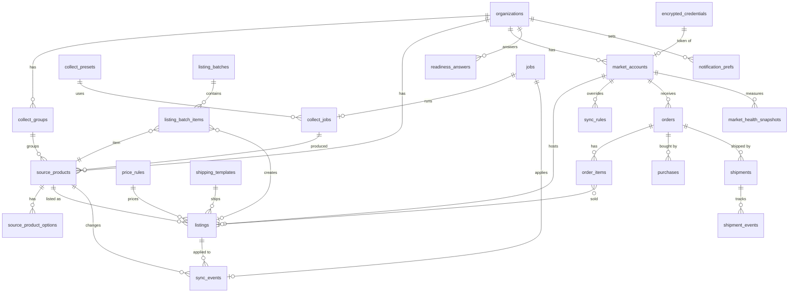

# 05 데이터 모델: GlobalSeller OS

작성일 2026-10-25. 정본 SQL은 `supabase/migrations/20261025000002_globalseller_domain.sql`(이하 `domain.sql`), 코어는 `supabase/migrations/20261025000001_core_lite.sql`(이하 `core_lite.sql`), 기본 데이터는 `supabase/seed.sql`이다. 표 이름·상태 값은 `docs/설계/DESIGN_STRUCTURE.md` 5.1·8장과 같다. 세 파일은 PGlite 검사(`supabase/README.md` 4장)를 통과했다(2026-10-25).

## 1. 개요와 ERD

스키마 두 개를 쓴다(01_PRD D-12 (a)). 코어 표는 `public`(platform-docs 코어 사본, 수정 금지), 제품 표 22개와 뷰 2개는 `globalseller`. 모든 제품 표는 `org_id`를 가지며 같은 조직 행끼리만 복합 FK `(org_id, id)`로 묶인다(다른 조직 행 참조 불가). 예외는 공용 참조 표 `fx_rates` 하나다.

코어 표(`organizations`, `org_members`, `plans`, `app_entitlements`, `credit_ledger`, `jobs`, `encrypted_credentials`, `oauth_states`, `audit_log`)는 참조만 한다.

## 2. 테이블

표준 컬럼: 모든 표에 `id`(uuid, 이력 표는 identity), `org_id`, `created_at`, 수정되는 표는 `updated_at`(코어 `set_updated_at` 트리거). 사용자가 만든 행은 `created_by`(감사 추적, FK 없음). 금액은 `*_krw bigint`(원), `*_minor bigint` + `currency`(ISO 4217, `^[A-Z]{3}$`).

### 2.1 수집 (S-02)

| 테이블 | 목적 | 주요 컬럼 | 제약 | `domain.sql` |
|---|---|---|---|---|
| `collect_groups` | 수집함 그룹 | `name`(1~60), `sort_order` | `unique(org_id, name)` | `:133-143` |
| `collect_presets` | 조건 필터 프리셋·정기 수집 | `filters`(04_API 4장 `CollectFilters`), `post_actions`(`translate`, `auto_queue`), `schedule_cron`, `schedule_enabled`, `last_run_at` | 정기 수집이 켜지면 cron 필수 | `:145-160` |
| `collect_jobs` | 대량·개별 수집 작업 | `method`(url, url_list, extension, keyword, schedule), `params`, `status`, `total_count`, `collected_count`, `passed_count`, `excluded_count`, `exclusion_reasons`(사유별 수), `job_id`(코어 잡), `request_id` | `(org_id, request_id)` 유일, 카운트 ≥ 0 | `:162-191` |
| `source_products` | 수집한 쿠팡 상품 | `coupang_product_id`(숫자), `coupang_item_id`, `source_url`(쿠팡 도메인만), `title_ko`, `brand`, `seller_name`, `category_path`, `delivery_type`(rocket, rocket_growth, seller, unknown), `price_krw`, `list_price_krw`, `stock_status`, `rating`(0~5), `review_count`, `images`, `notice`(고시정보), `review_summary`, `estimated_weight_g`, `risk_level`(ok, warn, block), `risk_flags`, `status`, `exclusion_reason`, `memo`(≤500), `last_checked_at`, `deleted_at` | 같은 조직·상품·아이템 1행(삭제 제외), 상품 수 한도 트리거 | `:193-244` |
| `source_product_options` | 옵션별 가격·재고·선택 | `option_name`, `coupang_item_id`, `price_krw`, `stock_status`, `selected`, `sort_order` | 상품 삭제 시 함께 삭제 | `:246-262` |

### 2.2 마켓 계정과 템플릿

| 테이블 | 목적 | 주요 컬럼 | 제약 | `domain.sql` |
|---|---|---|---|---|
| `market_accounts` | 연결된 마켓 계정(= 운영 화면 마켓 탭 1개) | `market_code`(카탈로그 코드, 예 `ebay_us`), `site`(국가 2자), `nickname`, `external_account_id`, `auth_type`(oauth, api_key), `credential_id`(코어 `encrypted_credentials`), `scopes`, `token_expires_at`, `status`, `currency`, `settings`(주문 수집 주기, 기본 가격 규칙·배송 템플릿, 재고 버퍼, 가져오기 여부), `sort_order`(탭 순서), `last_sync_at`, `last_error`, `connected_at`, `disconnected_at` | `unique(org_id, market_code, external_account_id)`, 계정 수 한도 트리거 | `:268-300` |
| `price_rules` | 가격 규칙 템플릿 | `target_margin_pct`, `min_margin_pct`, `rounding`(none, end_99, end_90, integer, jpy_10), `fx_buffer_pct`, `is_default` | 최소 ≤ 목표, 조직당 기본 1개 | `:302-319` |
| `shipping_templates` | 배송 템플릿 | `carrier`(epost_ems, k_packet, dhl_ecommerce, shopee_sls, other), `min_days`, `max_days`, `handling_days`, `cost_krw`, `weight_limit_g`, `is_default` | 최소일 ≤ 최대일, 조직당 기본 1개 | `:321-341` |

### 2.3 등록 (S-03)

| 테이블 | 목적 | 주요 컬럼 | 제약 | `domain.sql` |
|---|---|---|---|---|
| `listings` | 마켓별 리스팅 | `source_product_id`, `market_account_id`, `market_code`, `batch_id`, `sku`, `external_id`(ASIN·itemId), `language`, `title`(≤200), `bullets`(≤10), `description`, `keywords`, `category_id`, `category_path`, `attributes`, `images`, `currency`, `price_minor`, `quantity`, `cost_krw`·`shipping_cost_krw`·`fx_rate`·`fee_pct`(가격 계산 스냅샷), `expected_margin_pct`, `validation`(검사 결과 배열), `risk_level`, `status`, `last_error`, `imported`(기존 리스팅 가져오기), `submitted_at`, `live_at`, `ended_at`, `last_synced_at` | `unique(market_account_id, sku)`, 외부 id 유일, 전송 상태면 가격 필수, `risk_level = block`이면 ready·queued·submitting 불가 | `:377-438` |
| `listing_batches` | 일괄 등록 작업 | `market_account_ids`(1~10), `price_rule_id`, `shipping_template_id`, `options`, `status`, 항목 수 6종(total, passed, warned, blocked, submitted, failed), `request_id` | `(org_id, request_id)` 유일 | `:347-375` |
| `listing_batch_items` | 항목별 사전 검증·결과 | `batch_id`, `source_product_id`, `market_account_id`, `listing_id`, `verdict`(pass, warn, block), `reasons`, `status`(pending, queued, submitted, failed, skipped), `last_error` | `unique(batch_id, source_product_id, market_account_id)` | `:440-464` |

### 2.4 동기화 (S-04)

| 테이블 | 목적 | 주요 컬럼 | 제약 | `domain.sql` |
|---|---|---|---|---|
| `sync_rules` | 동기화 규칙. `market_account_id` null = 조직 기본, 값 = 계정 덮어쓰기 | `rule_key`(interval_min, oos_zero_stock, cost_up_recalc, fx_recalc, min_margin_hold, price_guard, buybox_watch, jpy_round_10, keep_listing_oos, token_auto_refresh, per_country_pricing), `enabled`, `params` | 범위·규칙당 1행 | `:470-489` |
| `sync_events` | 원본 변동 → 마켓 반영 로그 | `source_product_id`, `listing_id`, `market_account_id`, `change_type`(price_up, price_down, out_of_stock, restock, fx_change), 원화 전후 가격, 재고 전후, 외화 전후 가격, `margin_after_pct`, `status`, `reason`, `job_id`, `approved_by`, `detected_at`, `applied_at` | - | `:491-526` |
| `fx_rates` | 기준 환율(전 조직 공용) | `currency`(KRW 제외), `rate_krw`(외화 1단위당 원, numeric(18,6)), `source`, `fetched_at` | org_id 없음(예외) | `:529-537` |

### 2.5 주문·발주·배송 (S-05 · S-06 · S-07)

| 테이블 | 목적 | 주요 컬럼 | 제약 | `domain.sql` |
|---|---|---|---|---|
| `orders` | 마켓 주문 | `market_account_id`, `market_code`, `external_order_id`, `status`, `buyer_country`, `ship_to`(이름·주소·전화, 개인정보), `currency`, `total_minor`, `fee_minor`, `fx_rate`·`total_krw`·`fee_krw`(주문 시점 환산), `ordered_at`, `ship_by_at`, `claim_reason`, `pii_purged_at`, `last_synced_at` | `unique(market_account_id, external_order_id)` | `:543-577` |
| `order_items` | 주문 품목 | `listing_id`, `source_product_id`, `external_item_id`, `sku`, `title`, `quantity`(>0), `currency`, `unit_price_minor` | - | `:579-599` |
| `purchases` | 쿠팡 발주 기록 | `order_id`, `coupang_order_no`, `cost_krw`, `domestic_ship_krw`, `status`(ordered, delivered_to_warehouse, cancelled, refunded), `purchased_by`, `purchased_at`, `memo` | 금액 ≥ 0 | `:601-619` |
| `shipments` | 국제 송장 | `order_id`, `market_account_id`, `carrier`, `tracking_no`, `status`, `cost_krw`, `weight_g`, `eta_date`, 구간 시각 3개, `uploaded_to_market_at`, `last_event_at`, `last_error` | `unique(carrier, tracking_no)` | `:621-653` |
| `shipment_events` | 구간 이벤트(S-06 타임라인) | `shipment_id`, `occurred_at`, `status`, `location`, `description`, `raw` | 같은 이벤트 1행 | `:655-671` |

### 2.6 건전성·마법사·알림

| 테이블 | 목적 | 주요 컬럼 | 제약 | `domain.sql` |
|---|---|---|---|---|
| `market_health_snapshots` | 마켓 탭 지표 일별 스냅샷 | `market_account_id`, `snapshot_date`, `metrics`(odr, late_shipment_rate, pre_fulfillment_cancel_rate, valid_tracking_rate, on_time_delivery_rate, seller_level, defect_rate, lsr, nfr, chat_response_rate, api_usage_pct) | 계정·날짜당 1행 | `:677-689` |
| `readiness_answers` | 마켓 추가 마법사 여건 진단 이력 | `answers`(biz, tel, pay, card, region, cat, budget 키 필수), `answered_by` | 최신 행 = 현재 답변 | `:691-701` |
| `notification_prefs` | 알림 설정 | `user_id`(null = 조직 기본), `channel`(email, slack), `event_key`(order_received, api_error, daily_sales, weekly_report, price_anomaly, renewal_notice), `enabled`, `settings`(비밀 아닌 값) | 범위·채널·이벤트당 1행 | `:703-718` |

### 2.7 뷰

| 뷰 | 내용 | 비고 |
|---|---|---|
| `v_profit_monthly` | 월(KST)·마켓 계정별 주문 수, 반품 수, 매출·수수료·발주 원가·배송비(원), 순이익(원). 반품 주문은 매출 0에 원가·배송비만 손실로 잡는다 | `security_invoker`(호출자 RLS 적용), `domain.sql:820-852` |
| `v_market_tab_counts` | 마켓 계정별 탭 배지 수(동기화 대상, 진행 중 주문, 배송 중, 동기화 경고) | `domain.sql:854-871`, RPC `market_tab_counts`가 읽는다 |

## 3. 상태 전이

전이 표는 `globalseller.transition_allowed`(`domain.sql:54-105`) 한 곳에 있고 트리거 `globalseller.status_guard`가 INSERT·UPDATE마다 검사한다(service_role 쓰기도 포함). 위반은 GS001.

| 테이블 | 허용 전이 | 누가 | 부수 효과 |
|---|---|---|---|
| `source_products` | (신규)→collected / collected→reviewing·ready·excluded / reviewing→ready·excluded / ready→reviewing·listed·excluded / listed→ready / excluded→collected | 수집 워커(신규), 사용자 PATCH(검토·제외), 등록 워커(listed) | excluded는 상품 수 한도에서 빠진다 |
| `listings` | (신규)→draft, (가져오기)→live / draft→validating→ready·draft / ready→draft·queued / queued→submitting·draft / submitting→live·error / error→draft·queued / live→error·paused·ended / paused→live·ended | Route Handler(초안·검증·전송 요청), 워커(전송 결과·동기화) | live가 되면 원본 `source_products`를 listed로 |
| `sync_events` | (신규)→detected / detected→applied·held·skipped·failed / held→applied·skipped / failed→detected·applied | 동기화 워커, `approve_sync_event` | held는 손해 가격 보호(루트 `CLAUDE.md` 5장) |
| `orders` | (신규)→received·purchase_pending·shipped·delivered(가져올 때 마켓 상태 그대로) / received→purchase_pending·cancelled·cancel_requested / purchase_pending→purchased·cancel_requested / purchased→at_warehouse·shipped·cancel_requested / at_warehouse→shipped·cancel_requested / shipped→delivered·return_requested / delivered→return_requested / cancel_requested→cancelled·purchase_pending / return_requested→returned·delivered | 주문 워커, `record_purchase`, Route Handler(클레임) | 배송 완료 90일 뒤 `ship_to` 삭제(D-11) |
| `shipments` | (신규)→pending / pending→at_warehouse·departed·exception / at_warehouse→departed·exception / departed→customs·out_for_delivery·delayed·exception / customs→out_for_delivery·delayed·exception / out_for_delivery→delivered·delayed·exception / delayed→customs·out_for_delivery·delivered·exception / exception→departed·customs·out_for_delivery·delivered | 추적 워커, Route Handler(송장 등록) | delivered면 주문 delivered |
| `market_accounts` | (신규)→connecting / connecting→active·error·disconnected / active→token_expired·error·disconnected / token_expired→active·disconnected / error→active·disconnected / disconnected→connecting | OAuth 콜백, 토큰 크론, 연결 해제 | disconnected→connecting은 계정 수 한도를 다시 검사 |
| `collect_jobs`, `listing_batches` | (신규)→queued / queued→running·cancelled / running→completed·failed·cancelled / failed→queued | 워커, 취소 API | - |

## 4. RLS 정책

| 대상 | SELECT | INSERT·UPDATE·DELETE | GRANT |
|---|---|---|---|
| 제품 표 21개(`fx_rates` 제외) | `public.is_org_member(org_id)` | 정책 없음 = 사용자 쓰기 불가. 코어 `guard_privileged_write` 트리거가 한 번 더 막는다. 쓰기는 service_role(Route Handler·워커)과 RPC | authenticated: SELECT, service_role: ALL, anon: 없음 (`domain.sql:1084-1105`) |
| `orders` | 같음 | 같음 | authenticated는 `ship_to` 컬럼을 뺀 SELECT만. 배송지는 서버가 마스킹해 내려준다 |
| `notification_prefs` | 조직 멤버이면서 `user_id is null or user_id = auth.uid()` | 같음 | 다른 사용자의 개인 알림 설정은 보이지 않는다 |
| `fx_rates` | 로그인 사용자 누구나(`true`) | service_role만 | 공용 참조 |
| 뷰 2개 | `security_invoker`라 기반 표 RLS가 그대로 적용 | - | authenticated, service_role SELECT |
| RPC | `approve_sync_event`, `record_purchase`는 owner·admin·member, `market_tab_counts`, `plan_usage`는 조직 멤버. `enqueue_collect_job`은 service_role만 | - | `revoke execute ... from public, anon, authenticated` 후 필요한 것만(`domain.sql:1128-1140`) |

viewer는 모든 운영 화면을 읽을 수 있지만 쓰기 RPC에서 42501을 받는다. 역할 매핑: 프로토타입 팀 탭의 소유자 = `owner`, 관리자 = `admin`, 편집자 = `member`, 뷰어 = `viewer`(코어 `org_members.role`).

쓰기를 사용자 정책으로 열지 않은 이유: 모든 쓰기에 플랜 한도·상태 전이·멱등·감사가 붙어 Route Handler 한 곳에서 검사하는 편이 안전하다(platform-docs `core_lite.sql` 머리 주석 "쓰기는 service_role 또는 SECURITY DEFINER RPC만"). 콘텐츠 편집이 잦은 표(`listings` 초안)도 PATCH 경로로만 쓴다.

## 5. 인덱스와 성능

| 인덱스 | 조회 패턴 | 예상 규모(제안) |
|---|---|---|
| `source_products_org_status_idx (org_id, status, created_at desc)` | 수집함 목록·필터 | 조직당 2,000(Pro) |
| `source_products_recheck_idx (last_checked_at) where status = 'listed'` | 동기화 크론이 오래된 원본부터 | 전체 50,000 |
| `listings_org_status_idx`, `listings_account_status_idx` | 등록 현황, 마켓 탭 동기화 대상 수 | 상품 × 마켓 |
| `listings_external_uniq (market_account_id, external_id)` | 주문 품목 → 리스팅 매칭 | - |
| `sync_events_org_detected_idx`, `sync_events_account_idx`, `sync_events_held_idx` | 변동 로그 최신순, 탭별, 승인 대기 배지 | 일 수천 |
| `orders_org_status_idx`, `orders_account_status_idx`, `orders_ship_by_idx` | 상태 그룹·마켓 탭, 발송 기한 도래 | 월 수천 |
| `orders_profit_idx (org_id, ordered_at)` | 수익 분석 월 집계 | - |
| `shipments_tracking_poll_idx`, `shipments_upload_pending_idx` | 추적 크론, 송장 업로드 대기 | - |
| `market_accounts_token_idx (token_expires_at)` | 토큰 재발급 크론 | - |
| `fx_rates_latest_idx (currency, fetched_at desc)` | 최신 환율 1행 | 시간당 통화 수 |

`v_profit_monthly`는 조직당 주문 수만 건까지 실시간 집계로 충분하다(제안). 넘으면 월 단위 머티리얼라이즈드 뷰로 바꾼다(새 마이그레이션).

## 6. 코어 참조

| 코어 객체 | 용도 | 위치 |
|---|---|---|
| `organizations`, `org_members`, `profiles` | 조직 격리, 역할 | `core_lite.sql` SECTION 1 |
| `is_org_member`, `has_org_role`, `current_org_ids`, `is_service_caller`, `guard_privileged_write`, `set_updated_at`, `write_audit` | RLS·트리거·감사 | SECTION 0·5-A |
| `apps`, `plans`, `app_entitlements`, `has_entitlement`, `session_context`, `bootstrap_app_for_org` | 엔타이틀먼트·플랜 한도(`globalseller.features`) | SECTION 2 |
| `payment_orders`, `payments`, `billing_keys`, `webhook_events` | Toss 구독·크레딧팩 | SECTION 3 |
| `wallets`, `credit_ledger`, `consume_credits`, `refund_credits` | AI 번역 크레딧, `plan_usage` 사용량 | SECTION 4 |
| `oauth_states`, `create_oauth_state`, `consume_oauth_state` | 마켓 OAuth | SECTION 6-A |
| `encrypted_credentials`, `revoke_credential` | 마켓 토큰, API 키, 쿠팡 파트너스 키(provider `coupang_partners`), Slack 웹훅(provider `slack`) | SECTION 6-B |
| `rate_limit_buckets`, `rate_limit_hit` | Route Handler·마켓 호출 버킷 | SECTION 6-C |
| `jobs`, `enqueue_job`, `claim_jobs`, `complete_job`, `fail_job`, `cancel_job` | 모든 비동기 작업 | SECTION 7 |
| Storage `org-files`, `exports` | URL 목록 업로드, 내보내기 | SECTION 8 |
| `ai_routing_settings`, `resolve_ai_route`, `ai_usage` | 번역 체인 | SECTION 11 |

`public` 코어 표를 ALTER하지 않는다. 인증 단계는 스키마 변경이 없다(네이버 브리지 채택 시에도 코어 `auth_identity_links` 참조만, platform-docs `AUTH_ROADMAP.md` 10장).

## 7. 보안·데이터 결함의 차단 설계

신설 제품이라 원본 리뷰가 없다. 같은 도메인(nomad-commerce)의 보안·데이터 "높음" 결함과 이 제품 고유 위험을 막는다(비보안 항목은 02_ARCHITECTURE 6장).

| 출처 | 결함 요약 | 차단 설계 | 담당 장/작업 |
|---|---|---|---|
| `products/nomad-commerce/CLAUDE.md` 7장(평문 키 API) | 마켓 키를 평문으로 저장·반환 | `encrypted_credentials` 암호문만, `market_accounts`에는 `credential_id`만. API 응답에 토큰 필드 없음 | 2.2, 06장 마켓 계정 작업 |
| 같은 문서(`USING(true)` 정책) | 다른 조직 행 노출 | 모든 제품 표 `is_org_member(org_id)`. `true`는 공용 `fx_rates`만 | 4장, 06장 RLS 회귀 테스트 |
| 같은 문서(분리된·비원자 크레딧 차감) | 차감과 작업이 따로 놀아 이중 차감·무료 사용 | Route Handler 선차감 + 코어 잡 실패 자동 환불, 멱등 키 | 04_API 1장, 02_ARCHITECTURE 4.4 |
| 같은 문서(요청의 테이블 이름, 바디의 plan) | 클라이언트 값으로 권한 판단 | 플랜은 `globalseller.features(org)`만, 한도는 DB 트리거 | `domain.sql:26-52`, `:757-816` |
| 같은 문서(사용자 URL 직접 fetch, 원문 HTML 저장) | SSRF, 저장형 XSS | 쿠팡 URL은 허용 형식만 받고(`source_products_url_check`), 단건 조회는 `packages/net`(쿠팡 도메인 허용 목록, 사설 IP 차단)으로만. 추출한 값만 저장하고 HTML 원문 저장 컬럼은 없다 | `source_products_url_check`, 02_ARCHITECTURE 2장 |
| 같은 문서(콜백 오픈 리다이렉트) | 로그인 후 외부로 이동 | `next` 화이트리스트, OAuth `state` 1회용 소비 | 04_API 8장, 코어 6-A |
| 이 제품(다른 조직 행 연결) | 리스팅이 다른 조직 계정·상품을 가리킴 | 모든 FK를 `(org_id, id)` 복합 FK로 | 2장 전체 |
| 이 제품(구매자 개인정보) | 배송지 장기 보관·과다 노출 | `ship_to`는 authenticated 컬럼 권한 제외, 배송 완료 90일 뒤 삭제(D-11), eBay 계정 삭제 알림 시 즉시 삭제 | 4장, 04_API 5장 |
| 이 제품(손해 가격 자동 반영) | 원가 상승을 그대로 반영하지 않아 적자 판매, 또는 급락 반영 | 마진 하한 미달은 `held`, 승인 RPC로만 반영 | 3장, `domain.sql:935-971` |
| 이 제품(위험 상품 전송) | 항공 제한·상표권 상품을 그대로 전송 | `listings_no_block_submit_check` | `domain.sql:433` |
| 이 제품(중복 주문·리스팅) | 재시도로 같은 주문·SKU가 두 행 | `unique(market_account_id, external_order_id)`, `unique(market_account_id, sku)`, 송장 유일 | 2.3·2.5 |
| 이 제품(금액 실수 오차) | 소수 금액 계산 오류 | 금액 컬럼 bigint만, 환율·비율만 numeric | 2장 표준 컬럼 |

## 8. 모놀리스와 모듈러의 차이

| 항목 | 모놀리스(이번 개발) | 모듈러(platform-docs 통합 DB로 옮길 때) |
|---|---|---|
| 코어 위치 | `public`(core_lite 사본) | `core` 스키마(`_supabase-modular/0000~0009`) |
| 도메인 위치 | `globalseller` | `globalseller`(번호 2700, 제안) |
| 정책 함수 | `public.is_org_member` 등 | `core.is_org_member` 등. `public.` → `core.` 기계 치환 |
| 앱 등록 | `seed.sql`의 `apps` 행 | 조각 머리의 `core.apps` 등록 |
| 가입 부트스트랩 | 앱 행이 1개라 자동(`core_lite.sql` 머리 주석 b) | `signup_app` 메타데이터 또는 첫 진입 시 `bootstrap_app_for_org` |
| Realtime | `schemaname = 'globalseller'` 그대로 | 같음 |
| 선택한 [선택] 절 | Toss(3), 크레딧(4), OAuth state(6-A), 자격증명(6-B), 레이트 리밋(6-C), 잡(7), Storage(8). affiliate(9)만 제거 | 모듈러 코어 전체 |

## 9. 마이그레이션 파일

| 파일 | 줄 수 | 내용 |
|---|---|---|
| `supabase/migrations/20261025000001_core_lite.sql` | 3,378 | 코어 사본, affiliate 제거(머리 주석에 출처·제거 내용) |
| `supabase/migrations/20261025000002_globalseller_domain.sql` | 1,160 | 1 헬퍼(features, plan_limit, 전이 표, 상태 트리거) · 2 수집 · 3 계정·템플릿 · 4 등록 · 5 동기화 · 6 주문·발주·배송 · 7 건전성·마법사·알림 · 8 트리거 · 9 뷰 · 10 RPC · 11 RLS·GRANT · 12 Realtime |
| `supabase/seed.sql` | 81 | 앱 `globalseller`, 플랜 4종(free 기본, starter, pro, enterprise, `gs_*` features), 크레딧팩 2종, AI 라우팅 4행, 개발용 환율 4행 |

검사: `node check.mjs --vector mono core_lite domain seed` 세 파일 OK, 도메인·seed를 한 번 더 적용해도 OK(멱등). 모듈러 조각(`_supabase-modular/migrations/2700_globalseller.sql`)은 platform-docs에 등록할 때 만든다(06장 코어 요청).

## 10. 개발용 시드 페르소나 (인증 Stage A)

platform-docs `AUTH_ROADMAP.md` 2.2절 공통 페르소나를 그대로 쓰고, 제품 훅 `scripts/dev/seed-users.globalseller.mjs`가 운영 데이터를 더한다. 스키마 변경은 없다.

| 키 | 역할 | 제품 훅이 만드는 것 | 확인하는 것 |
|---|---|---|---|
| `owner` | 개인 조직 owner, 플랜 `pro`로 올림(service_role) | eBay US·Amazon US 계정 2개(status active, 가짜 credential), 수집 상품 30개(상태 골고루), 리스팅 40개, 주문 8건(프로토타입 주문 표와 같은 상태 분포), 송장 6건, 변동 9건(held 1건 포함) | 마켓 탭 숫자, 상태 그룹 필터, 수익 집계 |
| `admin` | owner 조직 admin(프로토타입 "관리자") | 없음 | 마켓 연결·해제, 결제 가능 |
| `member` | owner 조직 member("편집자") | 없음 | 등록·발주·승인 가능, 마켓 연결 403 |
| `viewer` | owner 조직 viewer("뷰어") | 없음 | 모든 화면 읽기, 쓰기 RPC 42501, 주문 배송지 컬럼 비노출 |
| `outsider` | 다른 개인 조직 owner(free) | 상품 1개 | owner 조직 행 0건(RLS), 상품 21번째에서 GS003 |
| `no_app` | 앱 없이 가입 | 없음 | 모놀리스는 자동 부트스트랩 → free 엔타이틀먼트 |
| `suspended` | 정지 | 없음 | 403 |

시드 스크립트는 로컬 Supabase URL(`127.0.0.1`·`localhost`)이 아니면 즉시 종료하고, 두 번 실행해도 행이 늘지 않는다(외부 id 기준 upsert).
