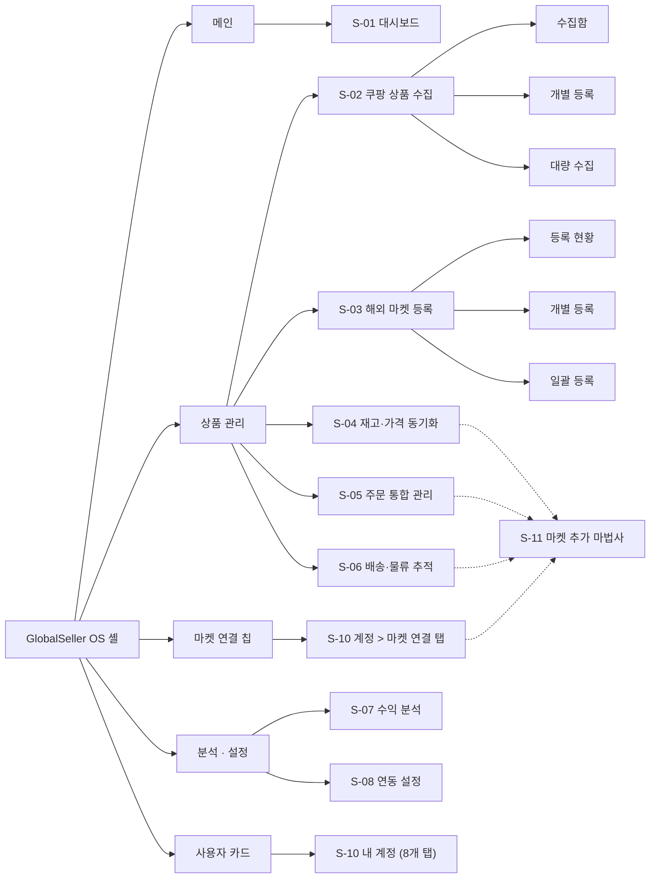
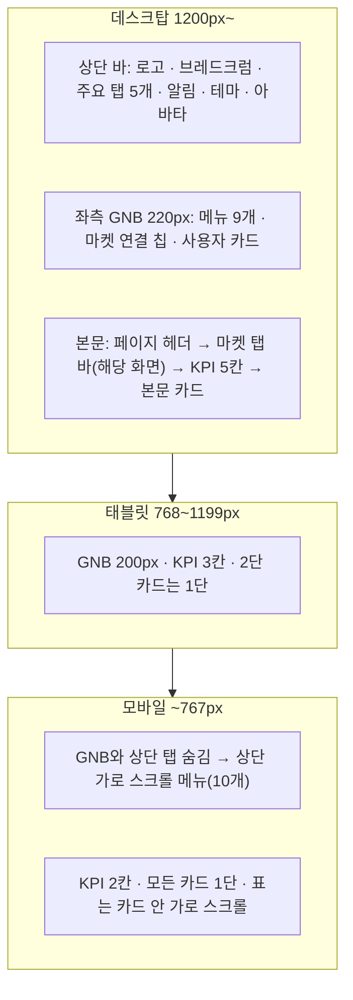
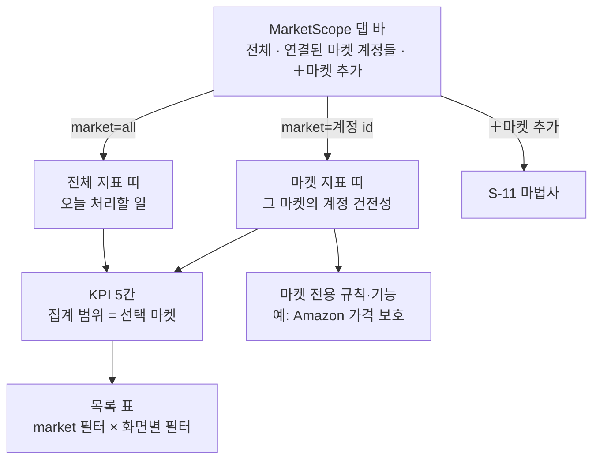
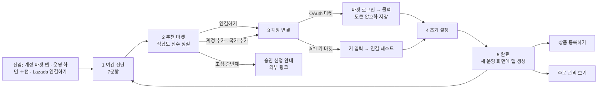
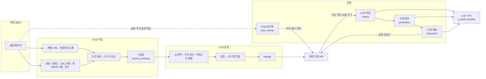
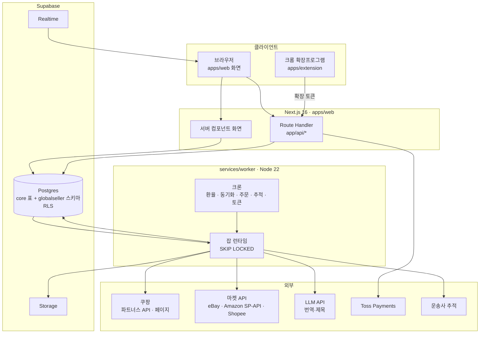
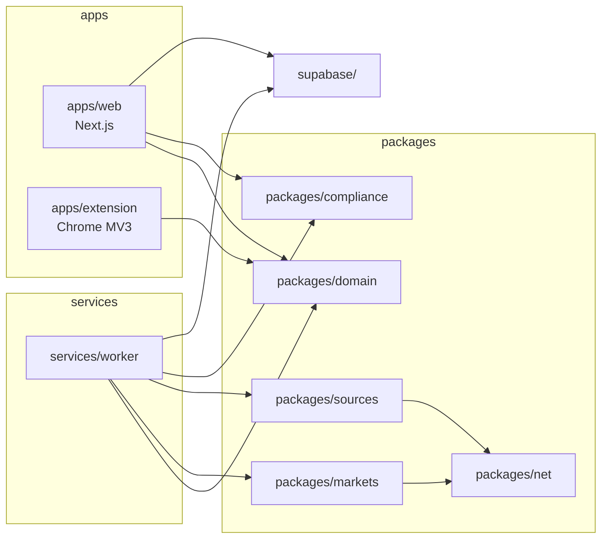

# DESIGN_STRUCTURE: GlobalSeller OS 디자인 구조

작성일 2026-10-25. 클릭 가능한 프로토타입(`prototype/index.html`, 2026-10-23 기획 업데이트 반영본)의 화면·탭·흐름을 그대로 구조로 옮긴 문서다. 기획서(`docs/기획서/`)와 개발서(`docs/개발서/`)는 이 문서의 **화면 ID, 라우트, 모듈 경로, 테이블 이름, 상태 값, 작업 ID 규칙**을 그대로 쓴다. 이 문서와 다른 이름을 쓰려면 이 문서를 먼저 고친다.

## 0. 고정 식별자

| 항목 | 값 | 비고 |
|---|---|---|
| 제품 이름 | GlobalSeller OS | 역직구 멀티채널 SaaS |
| 폴더·앱 id | `globalseller-os` / 앱 레지스트리 id `globalseller` | `core.apps` 행 |
| 약어 | `GS` | 작업 ID `GS-06-###`, 기능 ID `GS-F-###`, SQLSTATE `GS001~GS099` |
| DB 스키마 | `globalseller` | 모듈러 번호 2700(제안, platform-docs 등록 시) |
| 저장소 | `DevOps0906/GlobalsellerOS` | 이 저장소가 곧 개발 폴더 |
| 디자인 원본 | `prototype/index.html` | 화면 구조·문구·상태의 기준. 토큰 값은 08_DESIGN_SYSTEM이 정본 |

## 1. 정보 구조(IA)와 화면 목록

프로토타입 좌측 GNB의 순서를 그대로 쓴다. `구조도`는 프로토타입 설명용 화면이라 제품에서 빼고 개발 문서로 옮긴다.

| 화면 ID | 이름 | 라우트 (`apps/web/app/(app)/`) | 하위 탭 / 쿼리 | 프로토타입 요소 |
|---|---|---|---|---|
| S-01 | 대시보드 | `/dashboard` | 없음 | `#view-dashboard` |
| S-02 | 쿠팡 상품 수집 | `/collect` | `?tab=box\|single\|bulk` | `#view-products`, `#col-box` `#col-single` `#col-bulk` |
| S-03 | 해외 마켓 등록 | `/listings` | `?tab=status\|single\|bulk` | `#view-listing`, `#lst-status` `#lst-single` `#lst-bulk` |
| S-04 | 재고·가격 동기화 | `/sync` | `?market=all\|<market_account_id>` | `#view-sync` |
| S-05 | 주문 통합 관리 | `/orders` | `?market=…&status=all\|purchase_pending\|warehouse\|shipped\|claims` | `#view-orders` |
| S-06 | 배송·물류 추적 | `/shipping` | `?market=…&shipment=<id>` | `#view-shipping` |
| S-07 | 수익 분석 | `/profit` | `?period=month\|last_month\|90d` | `#view-profit` |
| S-08 | 연동 설정 (프로토타입 "API 설정") | `/settings/integrations` | 없음 | `#view-api` |
| S-09 | 아키텍처 구조도 | 제품에서 제외 | 이 문서 6장으로 이동 | `#view-arch` |
| S-10 | 내 계정 | `/account/[tab]` | `profile\|plan\|markets\|api-keys\|billing\|notifications\|security\|team` | `#view-account`, `#acc-*` |
| S-11 | 마켓 추가 마법사 | `/markets/connect` (인터셉트 라우트 `@modal/(.)markets/connect`) | `?step=1..5&market=<code>` | `#mk-modal` |

## 2. 셸 레이아웃 (반응형 3구간)

| 구간 | 폭 | 페이지 제목 | KPI 값 | 본문 | GNB |
|---|---|---|---|---|---|
| 모바일 | ~767px | 16px | 19px | 13px | 상단 가로 메뉴 |
| 태블릿 | 768~1199px | 18px | 21px | 14px | 좌측 200px |
| 데스크탑 | 1200px~ | 20px | 24px | 14px | 좌측 220px + 상단 탭 |

셸 동작 규칙: 상단 탭·좌측 GNB·모바일 메뉴는 **같은 라우트 하나**로 선택 상태가 함께 바뀐다(프로토타입 `data-view`). 사이드바 마켓 칩은 `/account/markets`로 간다. 상단 알림 아이콘은 `/orders`, 아바타는 `/account/profile`.

## 3. 마켓 탭 공통 패턴 (S-04 · S-05 · S-06)

세 화면은 같은 컴포넌트 `MarketScope`를 쓴다. 탭을 바꾸면 URL의 `market` 값이 바뀌고, 그 값 하나로 KPI·운영 지표·목록·규칙이 모두 다시 계산된다.

| 화면 | 전체 탭 지표 | 마켓 탭 지표 (예) | 목록 | 화면별 추가 필터 | 마켓 전용 기능 |
|---|---|---|---|---|---|
| S-04 동기화 | 연결 상태, 승인 대기, 기준 환율, 적용 규칙 | 마지막 동기화, API 사용률, 가격 보호, 반영 방식 | `sync_events` | 변동 유형 | Amazon 최저·최고가 보호, eBay 품절 시 리스팅 유지, Shopee 토큰 자동 갱신·국가별 가격 |
| S-05 주문 | 발송 기한 도래, 미답변 문의, 송장 미등록, 계정 경고 | Amazon ODR·지연 발송률·발송 전 취소율, eBay 판매자 등급, Shopee LSR·NFR | `orders` | 상태 그룹 5개 | 발송 확인 일괄 전송, 판매자센터 바로가기, SLS 송장 출력 |
| S-06 배송 | 출고 마감, 송장 미등록, 운송사 수, 통관 보류 | 유효 추적률, 정시 배송률, 배송 템플릿, 핸들링 타임 | `shipments` | 선택 배송 건 | 마켓별 송장 업로드 |

마켓 탭 하나 = 마켓 계정(`market_accounts`) 하나다. 같은 마켓에 계정이 둘이면 탭도 둘이다. 탭 순서는 계정 연결 순서이고, 마법사로 계정을 추가하면 세 화면에 탭이 동시에 생긴다.

## 4. 마켓 추가 마법사 (S-11)

| 단계 | 입력·표시 | 저장 |
|---|---|---|
| 1 여건 진단 | 사업자 형태, 통신판매업 신고, 해외 수취 계좌, 해외 결제 카드, 판매 지역(복수), 주력 카테고리(복수), 월 고정비 예산 | `readiness_answers` (조직당 최신 1행 + 이력) |
| 2 추천 마켓 | 마켓 카탈로그 × 답변 → 적합도 0~97, 상태(바로 연결 가능 / 준비 후 연결 / 목표 지역 외 / 초청·승인제 / 연결됨), 월 고정비·수수료·소요 기간·지원사업 배지 | 저장 없음 (계산은 `packages/domain/readiness.ts`) |
| 3 계정 연결 | 판매 국가, 계정 별칭, 요청 권한 4종, OAuth 버튼 또는 API 키 | `market_accounts`(status `connecting` → `active`), 토큰은 `core encrypted_credentials` |
| 4 초기 설정 | 기존 리스팅 읽기 전용 가져오기, 주문 수집 주기, 가격 규칙·배송 템플릿, 통화, 재고 버퍼, 운영 메뉴 탭 추가 | `market_accounts.settings`, 잡 `globalseller.listing_import` |
| 5 완료 | 다음 행동 3개 | 감사 `market_account.connected` |

## 5. 운영 데이터 흐름 (수집 → 정산)

### 5.1 상태 값 (DB check 제약과 같다)

| 대상 | 컬럼 | 값과 순서 | 화면 표시 |
|---|---|---|---|
| `source_products` | `status` | `collected` → `reviewing` → `ready` → `listed`, 분기 `excluded` | 수집함 필터 |
| `listings` | `status` | `draft` → `validating` → `ready` → `queued` → `submitting` → `live`, 분기 `error`, `paused`, `ended` | 등록 현황 |
| `sync_events` | `status` | `detected` → `applied` / `held`(승인 대기) / `skipped`(규칙상 유지) / `failed` | 반영·검토 필요·규칙상 유지·실패 |
| `orders` | `status` | `received` → `purchase_pending` → `purchased` → `at_warehouse` → `shipped` → `delivered`, 분기 `cancel_requested` → `cancelled`, `return_requested` → `returned` | 상태 그룹(아래) |
| `shipments` | `status` | `pending` → `at_warehouse` → `departed` → `customs` → `out_for_delivery` → `delivered`, 분기 `delayed`, `exception` | 배송 중·통관 중·지연·완료 |
| `market_accounts` | `status` | `connecting` → `active`, 분기 `token_expired`, `error`, `disconnected` | 연결됨·만료·미연결 |
| `collect_jobs` / `listing_batches` | `status` | `queued` → `running` → `completed`, 분기 `failed`, `cancelled` | 진행·완료 |
| `listing_batch_items` | `status` | `pending` → `queued` → `submitted`, 분기 `failed`, `skipped`(검증 `block`) | 일괄 등록 항목 결과 |
| `purchases` | `status` | `ordered` → `delivered_to_warehouse`, 분기 `cancelled`, `refunded` | 발주 상태 |

S-05 상태 그룹: 발주 대기 = `purchase_pending` / 배대지 = `purchased`, `at_warehouse` / 발송됨 = `shipped`, `delivered` / 취소·반품 = `cancel_requested`, `cancelled`, `return_requested`, `returned`.

## 6. 시스템 구성 (프로토타입 "구조도" 화면을 대체)

| 경계 | 규칙 |
|---|---|
| 브라우저 | Route Handler만 부른다. 마켓 API·LLM·쿠팡을 직접 부르지 않는다 |
| Route Handler | 세션 확인 → 크레딧 선차감(유료 작업) → 잡 등록. 마켓 API 호출은 연결 테스트·OAuth 콜백만 |
| 워커 | 마켓 API·쿠팡·LLM·운송사 호출은 워커에서만. 마켓 토큰 복호화도 워커에서만 |
| 비밀 값 | 마켓 토큰·API 키는 `encrypted_credentials`(AES-256-GCM). LLM 키는 워커 env에만. `NEXT_PUBLIC_` 금지 |

## 7. 저장소 모듈과 소유 에이전트

| 경로 | 내용 | 기본 담당 에이전트 |
|---|---|---|
| `apps/web/` | 화면, Route Handler, 세션, 디자인 토큰(`styles/tokens.css`) | `nextjs-expert` |
| `apps/extension/` | 쿠팡 페이지 수집 확장프로그램(MV3) | `worker-expert` |
| `services/worker/src/<영역>/handler.ts` | 잡 핸들러(자동 로드), `src/runtime/`, `src/cron/` | `worker-expert` |
| `packages/markets/<market>/` | `MarketAdapter` 구현: `ebay`, `amazon-sp`, `shopee`(P1), `lazada`·`qoo10`(P2) | `worker-expert` |
| `packages/sources/` | 쿠팡 URL 파서, 파트너스 API, CSV·XLSX 파서 | `worker-expert` |
| `packages/net/` | 안전 fetch(허용 도메인, 사설 IP 차단, 타임아웃) | `worker-expert` |
| `packages/compliance/` | 리스크 규칙(항공 제한, 브랜드, 금지어, 이미지 권한) | `worker-expert` |
| `packages/domain/` | 마켓 카탈로그, 수수료, 가격 공식, 상태 상수, GNB, 마법사 점수 | `sub-agent-1` |
| `supabase/` | 마이그레이션, 시드, RLS 테스트(`supabase/tests/`) | `supabase-expert` |
| `tests/e2e/` | Playwright E2E | `test-writer` |
| `docs/`, `tasks/` | 문서, 작업 상태 | 팀장 · `sub-agent-1` |

## 8. 데이터 모델 이름표 (스키마 `globalseller`)

| 테이블 | 한 줄 설명 | 주 화면 |
|---|---|---|
| `collect_groups` | 수집함 그룹(예: K-뷰티 · 마스크팩) | S-02 |
| `source_products` | 수집한 쿠팡 상품(원가·재고·리뷰·이미지·고시정보·리스크 플래그) | S-02, S-03 |
| `source_product_options` | 옵션별 가격·재고·수집 여부 | S-02 |
| `collect_jobs` | 대량 수집 작업(방식·조건·진행·수집/통과 수) | S-02 |
| `collect_presets` | 조건 필터 프리셋·정기 수집 일정 | S-02 |
| `market_accounts` | 연결된 마켓 계정(마켓 코드·국가·별칭·상태·토큰 참조·설정) | S-04~S-06, S-10, S-11 |
| `price_rules` | 가격 규칙 템플릿(목표·최소 마진, 끝자리, 환율 기준) | S-03 |
| `shipping_templates` | 배송 템플릿(운송사·기간·운임) | S-03, S-06 |
| `listings` | 마켓별 리스팅(번역 콘텐츠·가격·재고·외부 id·검증 결과) | S-03, S-04 |
| `listing_batches` / `listing_batch_items` | 일괄 등록 작업과 항목별 결과 | S-03 |
| `sync_rules` | 동기화 규칙(조직 기본 + 마켓 계정별 덮어쓰기) | S-04 |
| `sync_events` | 원본 변동 → 마켓 반영 로그 | S-04 |
| `fx_rates` | 기준 환율(통화쌍·시각) | S-03, S-04 |
| `orders` / `order_items` | 마켓 주문과 품목 | S-05, S-07 |
| `purchases` | 쿠팡 발주(주문번호·원가·상태) | S-05, S-07 |
| `shipments` / `shipment_events` | 송장과 구간 이벤트 | S-06 |
| `market_health_snapshots` | 마켓 계정 건전성 지표 일별 스냅샷(ODR, LSR 등) | S-04~S-06 마켓 탭 |
| `readiness_answers` | 마켓 추가 마법사 여건 진단 답변 | S-11 |
| `notification_prefs` | 알림 설정(이메일·Slack) | S-10 |
| 뷰 `v_profit_monthly` | 월·마켓별 매출·원가·수수료·배송비·순이익 | S-07 |
| 뷰 `v_market_tab_counts` | 마켓 탭 숫자 배지 | S-04~S-06 |

공용 코어 표(이름 그대로 사용, 고치지 않음): `profiles`, `organizations`, `org_members`, `audit_log`, `apps`, `plans`, `subscriptions`, `app_entitlements`, `payments` 계열, `wallets`, `credit_ledger`, `oauth_states`, `encrypted_credentials`, `rate_limit_buckets`, `jobs`.

## 9. 잡 큐와 크론

| 큐 (`jobs.queue`) | 트리거 | 핸들러 경로 |
|---|---|---|
| `globalseller.collect` | 개별·대량 수집 요청, 확장프로그램 담기 | `services/worker/src/collect/handler.ts` |
| `globalseller.translate` | 수집 후 AI 번역 옵션, 등록 화면 "AI 재생성" | `src/translate/handler.ts` |
| `globalseller.listing` | 개별 등록 전송, 일괄 등록 항목 | `src/listing/handler.ts` |
| `globalseller.listing_import` | 마법사 4단계 기존 리스팅 가져오기 | `src/listing-import/handler.ts` |
| `globalseller.sync` | 크론 30분, "지금 동기화" | `src/sync/handler.ts` |
| `globalseller.orders_import` | 크론 10분 | `src/orders/handler.ts` |
| `globalseller.tracking` | 크론 1시간, 송장 등록 직후 | `src/shipping/handler.ts` |

| 크론 | 주기 | 내용 |
|---|---|---|
| `fx` | 1시간 | 환율 갱신. 실패 시 직전 값 유지 |
| `sync` | 30분(규칙 값) | 리스팅이 있는 원본 상품 재확인 → `sync_events` |
| `orders` | 10분 | 마켓별 신규 주문 수집 |
| `tracking` | 1시간 | 운송사 추적 이벤트 |
| `token_refresh` | 마켓별(Shopee 4시간 등) | 만료 전 토큰 재발급 |
| `health` | 매일 03:00 KST | `market_health_snapshots` |

## 10. 작업 ID와 웨이브 규칙

| 항목 | 규칙 |
|---|---|
| 작업 ID | `GS-06-###` (001부터). 기획서 `06_AGENT_PLAN.md` 2장이 정본, `tasks/task-###.md`는 그 사본 |
| 웨이브 | W0 기반 → W1 인증·도메인 → W1-D 디자인 시스템 → W2 수집 → W3 등록 → W4 운영(동기화·주문·배송) → W5 수익·계정·마법사 → W6 E2E·보안(MVP 출시 조건) → W7 공개 베타 → W8 Phase 2 |
| MVP 마켓 | eBay US(P0), Amazon US(P0). Shopee SG·TH는 P1, Amazon JP·Lazada는 P2, Qoo10·Etsy·TikTok Shop은 P2 이후 |
| MVP 수집 경로 | URL 개별, URL 목록 업로드, 확장프로그램(P0). 파트너스 API 키워드 수집·정기 수집은 P1 |

## 11. API 경로와 금액 규칙

### 11.1 Route Handler (`apps/web/app/api/`)

| 경로 | 메서드 | 화면 | 하는 일 |
|---|---|---|---|
| `/api/collect/single` | POST | S-02 개별 | URL·상품번호 → 수집 잡 1건(미리보기 반환은 잡 완료 후 Realtime) |
| `/api/collect/jobs` | GET, POST | S-02 대량 | 대량 수집 작업 목록·생성(방식, 키워드, 필터 프리셋) |
| `/api/collect/jobs/[id]/cancel` | POST | S-02 대량 | 대기·진행 작업 취소 |
| `/api/collect/upload` | POST | S-02 대량 | CSV·XLSX 업로드 → 서명 업로드 URL 발급 후 잡 생성 |
| `/api/collect/presets` | GET, POST, PATCH | S-02 대량 | 조건 필터 프리셋·정기 수집 |
| `/api/extension/token` | POST | S-10 연동 | 확장프로그램용 단기 토큰 발급 |
| `/api/extension/items` | POST | 확장프로그램 | 확장 토큰으로 상품 담기(최대 50건/요청) |
| `/api/source-products` | GET | S-02 수집함 | 목록·필터 |
| `/api/source-products/[id]` | GET, PATCH, DELETE | S-02 | 상세, 그룹·메모·옵션 선택·제외 |
| `/api/listings` | GET, POST | S-03 | 등록 현황, 개별 등록 초안 생성 |
| `/api/listings/[id]` | GET, PATCH | S-03 개별 | 콘텐츠·가격·카테고리 수정 |
| `/api/listings/[id]/validate` | POST | S-03 개별 | 마켓별 필수 항목·리스크 검증 |
| `/api/listings/[id]/submit` | POST | S-03 개별 | 마켓 전송 잡 등록 |
| `/api/listings/[id]/translate` | POST | S-03 개별 | AI 재생성(크레딧) |
| `/api/listings/batches` | GET, POST | S-03 일괄 | 일괄 등록(규칙 템플릿 + 상품 목록) → 사전 검증 결과 |
| `/api/listings/batches/[id]/run` | POST | S-03 일괄 | 통과 항목 실행 |
| `/api/price-rules`, `/api/shipping-templates` | GET, POST, PATCH | S-03 | 템플릿 |
| `/api/pricing/preview` | POST | S-03, S-02 | 원가·배송비·환율·수수료·마진 → 마켓별 판매가 |
| `/api/sync/rules` | GET, PUT | S-04 | 기본 규칙과 계정별 덮어쓰기 |
| `/api/sync/run` | POST | S-04 | 지금 동기화(전체 또는 계정) |
| `/api/sync/events` | GET | S-04 | 변동 로그 |
| `/api/sync/events/[id]/approve` | POST | S-04 | 승인 대기(`held`) 반영 |
| `/api/orders` | GET | S-05 | 주문 목록(market × status) |
| `/api/orders/[id]/purchase` | POST | S-05 | 쿠팡 발주 기록(주문번호·원가) |
| `/api/orders/[id]/claim` | POST | S-05 | 취소·반품 처리 |
| `/api/orders/confirm-shipment` | POST | S-05 | 마켓에 발송 확인 일괄 전송(잡) |
| `/api/shipments` | GET, POST | S-06 | 송장 목록·등록(일괄 업로드 포함) |
| `/api/shipments/[id]` | GET | S-06 | 구간 이벤트 |
| `/api/profit` | GET | S-07 | 월별·마켓별·상품별 집계 |
| `/api/account/usage` | GET | S-10 플랜 | 플랜 한도 대비 사용량(`plan_usage`) |
| `/api/markets/catalog` | GET | S-11 | 마켓 카탈로그(정적) |
| `/api/markets/readiness` | GET, PUT | S-11 1단계 | 여건 진단 답변 |
| `/api/markets/connect/start` | POST | S-11 3단계 | OAuth state 발급 → 마켓 인증 URL |
| `/api/markets/callback/[market]` | GET | S-11 3단계 | OAuth 콜백 → 토큰 암호화 저장 |
| `/api/markets/accounts` | GET, POST | S-10, S-11 | 계정 목록, API 키 방식 계정 추가 |
| `/api/markets/accounts/[id]` | PATCH, DELETE | S-10 | 설정 변경, 연결 해제 |
| `/api/markets/accounts/[id]/test` | POST | S-10, S-11 | 연결 테스트 |
| `/api/billing/*` | - | S-10 플랜·결제 | 코어 Toss 흐름 그대로 |
| `/api/webhooks/toss` | POST | - | 결제 웹훅(코어) |
| `/api/webhooks/ebay/account-deletion` | GET, POST | - | eBay 계정 삭제 알림(챌린지 응답 포함) |
| `/api/dev/login` | POST | - | 인증 Stage A Mock 로그인(로컬 전용) |

### 11.2 RPC (스키마 `globalseller`, SECURITY DEFINER, service_role 또는 세션 검증)

| 이름 | 하는 일 |
|---|---|
| `enqueue_collect_job` | 크레딧 선차감 없이 수집 잡 생성(수집은 무료, 플랜 한도만 확인) |
| `approve_sync_event` | `held` → `applied` 대기열 등록, 감사 기록 |
| `record_purchase` | 주문 → `purchased`, 원가 기록 |
| `market_tab_counts` | 화면별 마켓 탭 배지 숫자 |
| `plan_usage` | 플랜 한도 대비 사용량(상품 수, 마켓 수, AI 번역, 멤버) |

### 11.3 금액 규칙

| 대상 | 저장 | 표시 |
|---|---|---|
| 원화 (쿠팡 원가, 배송비, 발주 금액) | `bigint` 원 단위 정수, 컬럼 이름 끝 `_krw` | 세 자리 쉼표 + `원` 또는 `₩` |
| 외화 (판매가, 수수료, 주문 금액) | `bigint` 최소 단위 정수(USD 센트, JPY 엔, SGD 센트), 옆에 `currency` 3자리 | 통화 기호 + 소수 자리(통화별) |
| 환율 | `numeric(18,6)` 1단위 외화당 원 | 표시 소수 2자리 |
| 마진율 | `numeric(5,2)` 퍼센트 | 정수 % |

실수(`double`, JS `number` 소수 연산)로 돈을 계산하지 않는다. 가격 공식은 `packages/domain/pricing.ts` 하나만 쓴다.
